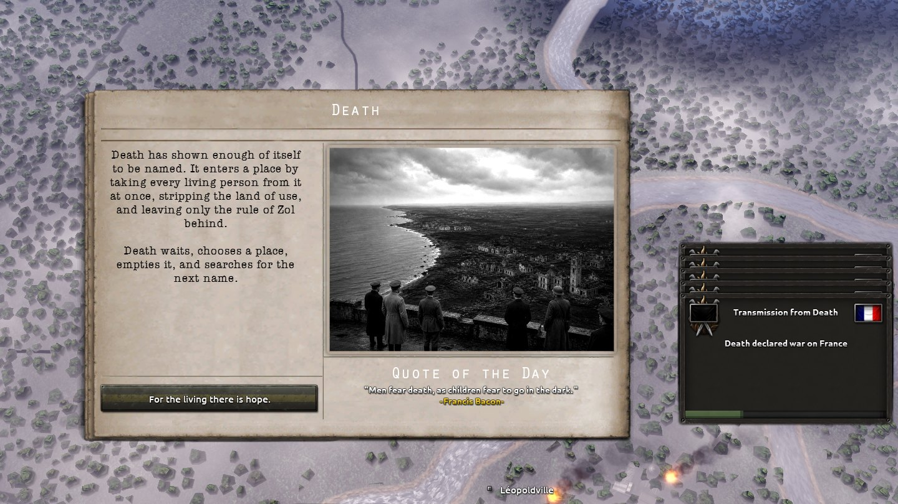
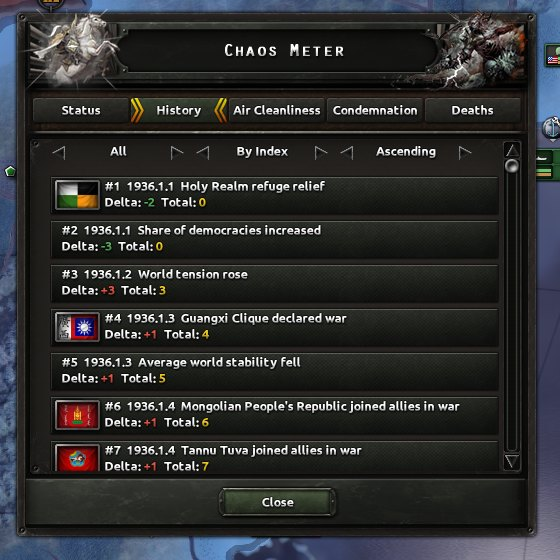
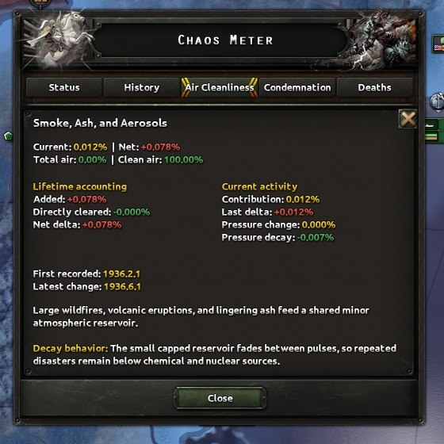
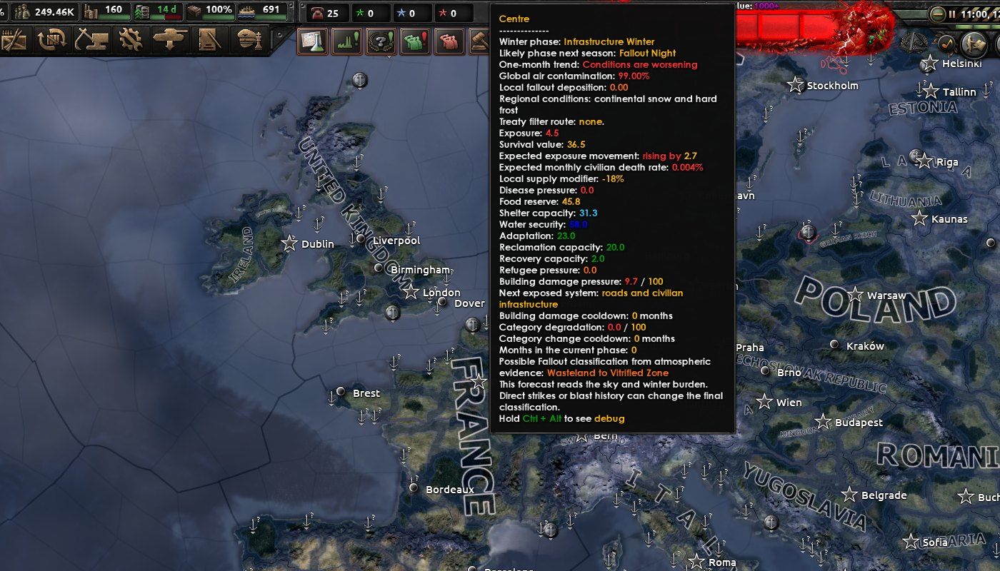
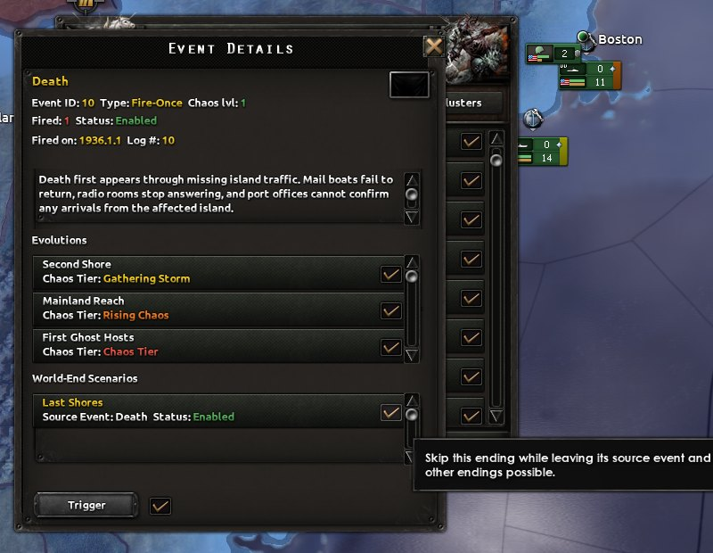
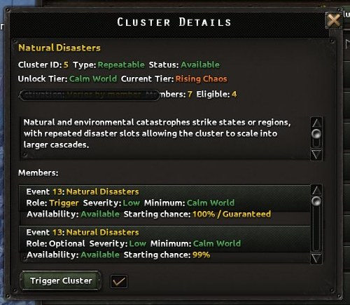
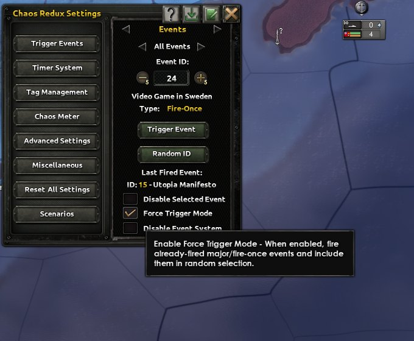
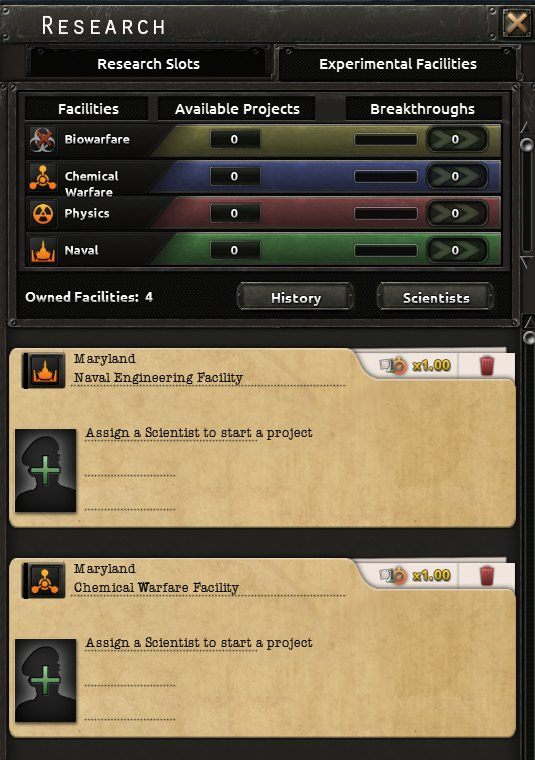
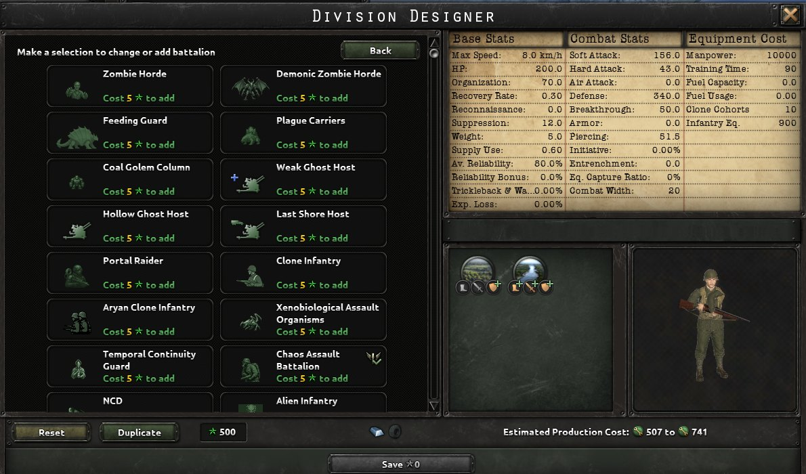
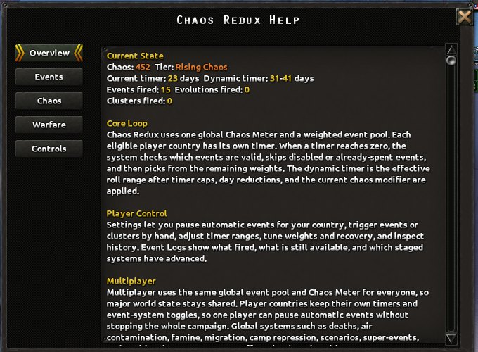

# Chaos Redux: Complete Mechanics Guide

Chaos Redux brings an unpredictable world to Hearts of Iron IV.
Wars, disasters, population losses, and unconventional weapons can deepen a crisis, while peace, relief, and preparation can help your country endure it.
This guide explains the shared systems, the choices they offer, and where to find them during a campaign.

## Table of Contents

1. [Core Event System](#core-event-system)
2. [Dynamic Timer System](#dynamic-timer-system)
3. [Event Classification](#event-classification)
4. [Chaos Meter System](#chaos-meter-system)
   - [Air Cleanliness](#air-cleanliness)
   - [Condemnation](#condemnation-system)
   - [Deaths](#deaths-system)
5. [Civilian Crises](#civilian-crises)
   - [Famine](#famine-mechanics)
   - [Migration](#migration-mechanics)
6. [World End Scenario Mechanic](#world-end-scenario-mechanic)
7. [Event Evolution](#event-evolution)
8. [Event Logs](#event-logs)
9. [Event Clusters](#event-clusters)
10. [Configuration and Settings](#configuration-and-settings)
11. [Triggerable Scenarios](#triggerable-scenarios)
12. [Multiplayer Compatibility](#multiplayer-compatibility)
13. [Chemical and Biological Warfare](#chemical-and-biological-warfare)
    - [Research and Special Projects](#research-and-special-projects)
    - [Chemical Warfare](#chemical-warfare)
    - [Biological Warfare](#biological-warfare)
14. [Camps and Genocide Mechanics](#camps-and-genocide-mechanics)
15. [Chaos Warfare](#chaos-warfare)
16. [CBRN Command, Protection, and Diplomacy](#cbrn-command-protection-and-diplomacy)
17. [Special Units](#special-units)
18. [Campaign Tools](#campaign-tools)

---

## Core Event System

### Overview

Events respond to the state of the world and the history of your campaign.
Some bring local trouble, others reshape international politics, and some grow into much larger crises over time.

### Core Principles

- **Changing Conditions**: Available events depend on the countries, conflicts, and crises around you.
- **Campaign History**: Earlier events affect what can happen next and how likely it is.
- **Escalating Danger**: Higher Chaos brings shorter pauses and more dangerous developments.
- **Player Choice**: Settings let you choose which events are enabled and how quickly the campaign develops.

### Country Crises

When a local crisis can choose between countries, it is less likely to select one already facing several crises.
Crises that follow this rule share a limit of three active crises per country.
Worldwide dangers can still affect those countries.

Some crises also become more likely as an affected country approaches capitulation.
This can bring a late turning point, but it does not guarantee rescue or survival.

Player countries face harder versions of the crises that support it, with higher chances and shorter cooldowns than the same crises give AI-only fronts.
There is no setting that switches this off.

### World Threats

An existential danger can put the world under threat.
That danger can influence opportunities for cooperation and urgent responses, though countries still face their own political choices and conflicts.

---

## Dynamic Timer System

### Timer Mechanics

The pause between automatic events changes throughout the campaign.
At the default settings:

- **Opening Event**: The first countdown lasts 7–30 days.
- **Normal Pause**: Later countdowns begin from a range of 45–60 days.
- **Minor Events**: A run of smaller events gradually shortens the pause.
- **Major Events**: A major event clears that accumulated acceleration.
- **Minimum Pause**: The countdown cannot fall below 2 days.

Each player country keeps its own countdown.
The optional timer window keeps the current countdown visible during play.

### Timer Acceleration

Each minor event shortens the next countdown range by one day, up to a 15-day reduction.
Every three minor events also reduce the longest possible pause by another day, up to five extra days.

| Minor events since the last major event | Next countdown in a Calm World |
| --- | --- |
| 0 | 45–60 days |
| 1 | 44–59 days |
| 3 | 42–56 days |
| 6 | 39–52 days |
| 9 | 36–48 days |
| 12 | 33–44 days |
| 15 or more | 30–40 days |

### Chaos Effects on Timing

Chaos shortens these pauses further.
After a major event, the normal countdown range returns, but the current Chaos tier still affects it.

| Chaos tier | Countdown length compared with a Calm World | Shortest range after a long run of minor events |
| --- | --- | --- |
| **Calm World** | Normal | 30–40 days |
| **Gathering Storm** | 20% shorter | 24–32 days |
| **Rising Chaos** | 30% shorter | 21–28 days |
| **Chaos Tier** | 40% shorter | 18–24 days |
| **Total Chaos** | 50% shorter | 15–20 days |
| **World Collapse** | 50% shorter | 15–20 days |

---

## Event Classification

### Event Availability

An event needs suitable countries and world conditions before it can occur.
Every normal event also has a minimum Chaos tier.
An unavailable event shows **N/A** in the event list; its details explain the required tier or the other condition that is missing.

These requirements are separate from the conditions for later evolutions and linked event groups.
Reaching the right Chaos tier makes an event possible, but does not guarantee it will happen next.

### Event Types

| Event type | How it behaves | What it means for the campaign |
| --- | --- | --- |
| **Fire-Once** | Can occur once per campaign. | Often begins as a local or regional development that may have lasting consequences. |
| **Repeatable** | Can occur several times, becoming less likely after each occurrence. | Recurring trouble remains possible, but the same event becomes less dominant over time. |
| **Major** | Becomes more likely as minor events occur, and can happen once. | Brings an immediate large change and resets the buildup toward other major events. |

The **Weight** shown in the event list describes relative likelihood, rather than a percentage chance.
With default settings, ordinary events begin at 1,000.
After a repeatable event occurs, its likelihood gradually recovers by 20 each month, up to a maximum that halves with each occurrence.

Major events build up from minor events.
The amount of that buildup adjusts to the mix of available major and ordinary events, so changing the event selection also affects pacing.

### Super Events

Major developments can appear as large illustrated announcements with music.
Their presentation marks the importance of the moment; the accompanying text explains what it means for the world.

---

## Chaos Meter System

### Chaos Meter Overview

The global Chaos Meter measures world instability from 0 to 1,000 and beyond.
Every country shares the same world conditions, even when the immediate dangers differ from place to place.

### Chaos Meter Window

Click the meter in the top bar, or press **Ctrl+Shift+M**, to open the window and explore five tabs:

1. **Status**: The current Chaos value and tier.
2. **History**: Changes to Chaos, with filters and sorting.
3. **Air Cleanliness**: Global contamination, its causes, and Air Winter conditions.
4. **Condemnation**: Public responsibility for unconventional warfare and atrocities.
5. **Deaths**: Civilian and military losses, including country totals and causes.

The window opens on **History**.
Each History row shows the date, the reason, the country responsible, the change, and the resulting total.
Several wars declared by one country on the same day are merged into one row.

[Recording: browsing the Chaos Meter tabs](docs/images/mechanics/chaos_meter_tabs.mp4)

### Chaos Tiers

| Tier | Chaos | World conditions |
| --- | --- | --- |
| **Calm World** | 0–199 | Normal event pacing and the lowest level of instability. |
| **Gathering Storm** | 200–399 | Shorter pauses and some crisis evolutions. |
| **Rising Chaos** | 400–599 | More frequent events and further escalation. |
| **Chaos Tier** | 600–799 | Frequent events and many dangerous developments. |
| **Total Chaos** | 800–999 | Very short pauses and most evolutions within reach. |
| **World Collapse** | 1,000 or more | The highest Chaos tier, where world-ending crises may meet their requirements. |

### Chaos Sources

War, conquest, military expansion, and rising world tension increase instability.
Peace and liberation can reduce it.
Changes involving major powers usually have a larger effect.

| Action or condition | Effect on Chaos |
| --- | --- |
| War begins | +1, or +5 for a major change |
| Peace is made | −1, or −3 for a major change |
| Annexation | +2, or +10 for a major change |
| A puppet is created | +1, or +3 for a major change |
| Liberation | −2, or −5 for democratic liberation |
| A country is freed | −3 |
| A subject becomes independent | −1, or −3 for a major change |
| A subject is annexed | +2 |
| Joining a faction | +1, or +3 for a major change |
| Leaving a faction | −1, or −3 for a major change |
| A faction is created | +2 |
| A coup is staged or succeeds | +1 each |
| A country capitulates | +1, or +3 for a major power |
| A country is restored after capitulation | −1 |
| A government goes into exile | +1 |
| An exiled government is reinstated | −1 |
| A country joins its allies in a war | +1 |
| A major power guarantees another country's independence | +1 |
| A major power's war goal expires | −1 |
| Monthly natural decline | −1 |

Ideological changes also affect Chaos: democratic changes reduce it, while other changes can raise it.

Further pressure comes from military growth, deaths, and pollution:

- **World Tension**: Each percentage-point increase adds 1 Chaos.
- **Military Buildup**: Every 100 military factories or 100 divisions contributes 1 Chaos.
- **Deaths**: Every million recorded deaths adds 1 Chaos, and a few causes count at a reduced weight.
- **Air Contamination**: Each percentage-point rise adds 1 Chaos; an equivalent recovery removes 1.
- **Nuclear Use**: Successive nuclear and thermonuclear strikes share a declining Chaos increase of 10, 5, 3, 2, then 1 per use.
  Nuclear tests, accidents, and demonstrations add smaller amounts.

Events can also change Chaos directly.

### Air Cleanliness

Air Cleanliness shows how much of the atmosphere remains clean and how much is contaminated.
Chemical contamination, disease outbreaks, nuclear fallout, wildfire smoke, volcanic ash, asteroid dust, and acid rain contribute to the global total.

Pollution can continue to build after the original attack or disaster.
Repeated nuclear strikes leave heavier and longer-lasting fallout, while recovering states gradually reduce their contribution.

#### Natural Recovery

The atmosphere slowly recovers while contamination remains reversible.
Recovery becomes weaker as pollution rises.

| Global contamination | Natural recovery each month |
| --- | --- |
| Below 25% | 0.03 percentage points |
| 25% to below 50% | 0.02 percentage points |
| 50% to below 75% | 0.01 percentage points |
| 75% to below 100% | 0.005 percentage points |

Ongoing pollution can outweigh this recovery.

#### Contamination Thresholds

| Contamination | Consequence |
| --- | --- |
| **25%** | Disease outbreaks spread more easily. |
| **50%** | Mild nuclear-winter conditions can begin. |
| **75%** | Severe nuclear-winter conditions can begin, and countries can form the Air Cleanliness Treaty. |
| **100%** | Atmospheric damage becomes irreversible and can lead to a contamination-driven world end when enabled. |

The **Air Cleanliness** tab shows the current total, recent changes, and the contribution of each source.
Select a source to see its history, including earlier pollution that has already cleared.
A switch in the tab pauses and resumes ordinary Air Cleanliness processing.

#### Air Winter

Air Winter turns atmospheric pollution into a local struggle for survival.
States pass through seven stages: **Open Sky**, **Dim Frost**, **Failed Season**, **Infrastructure Winter**, **Black Winter**, **Dead Sky**, and **Fallout Night**.
The winter conditions affecting a state are named **Dim Frost**, **Crop Shock**, **Hard Freeze**, **Black Harvest**, **Ash Winter**, and **Terminal Winter**.

Conditions differ between states.
Local contamination, damaged infrastructure, occupation, and nearby severely affected states can worsen the danger.
Food reserves, shelter, adaptation, cleanup, and relief routes help reduce it.

- **Early Stages**: Food supplies and living conditions come under pressure.
- **Severe Stages**: Civilian deaths, disease, supply problems, and building damage become lasting threats.
- **Recovery**: Sustained improvements are needed before a state moves back toward safer conditions.

Use the Air Winter map mode to identify the hardest-hit regions and follow their recovery.

Choose priority states for relief and safer receiving states for evacuees.
Response projects include distributing respirators, supporting clinics, protecting crops and transport routes, building shelter, and preparing evacuations.
Severe conditions can force choices about abandoning an area or sealing bunkers.

#### Air Cleanliness Treaty

At 75% contamination, eligible countries can form a treaty to cooperate against the worsening atmosphere.
Members share basic observations and can support joint relief projects.

- **Global Cleaning Day**: A 45-day project that uses equipment, convoys, and civilian factories to reduce global contamination by one percentage point.
- **Joint Filter Convoy**: Aid for another member's severely affected priority state, improving protection and recovery and supporting a relief route for up to six months.
- **Verification Missions**: Inspections that test whether members are honoring their commitments.

Using unconventional weapons or refusing an inspection can lead to expulsion and sanctions from the remaining members.
Betrayal remains part of a country's treaty history.

<!-- IMAGE PLACEHOLDER: In-game treaty decisions showing a joint relief project and its requirements. -->

### Condemnation System

Condemnation measures the international response to publicly known unconventional attacks, atrocities, and cover-ups.
Responsibility can remain hidden until inspections, discovery, occupation, or published evidence expose it.

Chemical, biological, nuclear, atrocity, cover-up, and repeated-use consequences are shown separately.
Possessing weapons alone does not count as using them.

| Condemnation | International standing |
| --- | --- |
| Below 25 | Normal |
| 25–49 | International Concern |
| 50–99 | Formal Censure |
| 100–174 | Arms Embargo |
| 175–299 | Strategic Embargo |
| 300–499 | Total Embargo |
| 500 or more | Pariah State |

Concern and censure damage relations and military support.
Higher tiers can bring broader economic and diplomatic restrictions from participating countries.
Volunteers and attachés may be recalled, and new lend-lease agreements from sanctioning countries can be blocked.
Existing lend-lease agreements, production licences, and research-sharing arrangements can remain in place.

Trade embargoes require **By Blood Alone**.
Other economic and diplomatic sanctions still apply without that expansion.

A condemned country can answer in three ways through the Condemnation Response decisions.
Compliance choices include accepting inspections, destroying stockpiles, dismantling restricted sites, paying compensation, issuing a non-use pledge, allowing observers, and reforming its unconventional command.
Defiance choices include refusing inspections, emergency autarky, forced extraction, substitute materials, and hardline mobilization.
Evasion routes such as black-market arms and false manifests ease the pressure but risk further condemnation if they are exposed.
The cost of these responses rises as Condemnation grows.

Select a country in the **Condemnation** tab to inspect its public record, current penalties, recent incidents, and progress toward the next tier.

### Deaths System

The **Deaths** tab brings together military casualties and civilian losses from bombing, unconventional warfare, fallout, famine, repression, and dangerous displacement.
It shows worldwide totals, the civilian and military split, and country totals; hover over a country's values to see the causes.

Civilian losses reduce a state's population and have lasting consequences for the people and resources available there.
Moving to another state is counted as migration; people who die during dangerous journeys are recorded separately as deaths.

---

## Civilian Crises

Civilian crises can weaken a country far from the front line.
Food shortages force people to leave, damaged routes obstruct relief, and overwhelmed receiving areas struggle to provide shelter and supplies.

### Famine Mechanics

Famine follows conditions in individual states.
Its decisions appear when there is a food-security problem, while the famine map mode is available from the start of the campaign.

#### Food Security

Three values describe the situation:

- **Food Security**: How serious the shortage has become.
- **Food Reserves**: Supplies available to help people through a shortage.
- **Relief Access**: How easily food and assistance can reach those in need.

Food Security has five stages: **Stable**, **Supply Strain**, **Acute Shortage**, **Famine**, and **Catastrophic Famine**.
Production, transport, food demands, extraction, environmental damage, and relief all affect conditions.
Sustained severe shortages can cause civilian deaths.

#### Relief and Recovery

Available responses include releasing reserves, emergency imports, repairing routes, escorting relief convoys, airlifts, inviting outside assistance, and evacuating people from danger.
Taking supplies from safer areas can help one region while placing a burden on another.
Concealment and continued extraction can deepen the crisis.

Blockades become a famine threat when isolation and disrupted transport leave a state without adequate local supplies or relief.
Being an island alone does not cause famine.

<!-- IMAGE PLACEHOLDER: In-game famine map and relief decision showing Food Security, Food Reserves, and Relief Access. -->

### Migration Mechanics

People may flee danger within their own country or cross a border in search of safety.
Migration decisions appear when displacement, trapped populations, or reception needs become significant.
The migration map mode is available from the beginning of the campaign.

#### Displacement and Reception

Three values guide your response:

- **Displacement Load**: The pressure created by people forced from their homes.
- **Reception Capacity**: Your ability to receive and support them.
- **Border Policy**: The rules governing entry, transit, and return.

Policies range from **Humanitarian Entry** and **Controlled Entry** to **Transit Only**, **Controlled Medical Entry**, and **Closed Border**.
Harsher policies include **Violent Enforcement** and **Forced Return** where those choices are available.

Closed borders can leave people trapped in danger.
Receiving too many people without enough capacity can overcrowd safer states and strain their supplies.

#### Evacuation, Settlement, and Return

You can prepare evacuations, arrange corridors, prioritize transport, provide medical reception, distribute arrivals, or help them continue to another destination.
Longer-term choices include local integration, resettlement in another country, and return home.

Successful movement reduces the population at the origin and adds survivors to the destination.
Unsafe routes, violent rejection, and forced return can cause deaths.
Famine can drive further flight, while trapped populations add to the need for food and relief.

<!-- IMAGE PLACEHOLDER: In-game migration map showing an area of flight, a closed route, and a receiving state. -->
<!-- IMAGE PLACEHOLDER: In-game reception decisions showing Displacement Load, Reception Capacity, and Border Policy. -->

---

## World End Scenario Mechanic

Reaching 1,000 Chaos places the world in **World Collapse**.
A world end still needs its own conditions to be met; reaching the tier alone does not immediately end the campaign.

### Key Rules

- **Different Requirements**: Each ending depends on the crisis or world conditions behind it.
- **Separate Controls**: Available endings can be enabled or disabled individually in Event Details.
- **Global Switch**: **Disable World End** in the Chaos Meter section of the settings turns the whole mechanic off.
- **Automatic Events Stop**: Once a world end begins, ordinary automatic event firing stops worldwide.
- **Lasting Consequences**: The ending determines what kind of world remains and what survival means afterward.

Atmospheric collapse has a separate **Disable Fallout** setting.
Once that transition has begun, the setting cannot reverse it.

---

## Event Evolution

An event's first appearance may only be the beginning.
Higher Chaos, earlier developments, and changing world conditions can allow it to evolve into a more dangerous crisis.

Check Event Details to see possible evolutions and their requirements.
An evolution has its own history entry, making it easier to follow a crisis across the campaign.

---

## Event Logs

The Event Logs window shows what has happened and what may still happen.
Open it from the Settings window, press **Ctrl+Shift+E**, or press **Ctrl+E** to open it directly on the Events tab.

| Tab | What it shows |
| --- | --- |
| **Status** | An overview of event activity and pacing. |
| **History** | Past events, their dates, and the countries involved where relevant. |
| **Evolutions** | Crisis milestones and later developments. |
| **Events** | The event list, availability, likelihood, and enable/disable controls. |
| **Clusters** | Linked groups of events, their availability, and their members. |

You can filter the event list by enabled state or by event type.
Sorting helps you find events by number, times fired, weight, or required Chaos level.

Select a row to open its details.
Several detail windows can remain open together, and cluster details let you inspect individual members.
Where an event has public world-end branches, each has its own details and checkbox.

---

## Event Clusters

Clusters group related events into a connected burst of trouble.
They have their own availability requirements and can become possible at different Chaos tiers.
Individual members must also meet their own conditions.

Nineteen clusters are available: Wars, Liberations, Diplomacy, Peace, Natural Disasters, Formables, Positive Economy, Intelligence, National Breakthroughs, Negative Economy, Various Anomalies, Pacts, Diseases, Randomizations, Sudden Abundance, Domestic Unrest, Alien Invasions, Military Preparation, and Random Stuff.
Random Stuff has no fixed members.
At higher Chaos tiers it can draw several events from everything that is currently possible.

A cluster does not guarantee that every member will occur.
The **Clusters** tab shows which members are available and what happened during a previous activation.

A linked burst normally counts as one development for event pacing, so several members do not each shorten the next pause.
You can enable or disable a whole cluster from its list or detail window.

---

## Configuration and Settings

Open the Settings window with **Ctrl+Shift+C**.
It has these sections: **Trigger Events**, **Timer System**, **Tag Management**, **Chaos Meter**, **Advanced Settings**, **Miscellaneous**, **Reset All Settings**, and **Scenarios**.
The Help window opens from its title bar.

### Trigger Events

Settings let you shape the campaign's pace and selection of events.

- **Event Selection**: Pick an event number, filter the choices by All Events, Fire-Once, Repeatable, or Major, and turn individual events or clusters on and off.
- **Manual Triggering**: Choose an event and start it directly with **Trigger Event**.
- **Random Selection**: **Random ID** picks an event at random before you choose whether to trigger it.
- **Force Trigger Mode**: Bypass normal restrictions for a manually chosen event, including events that already fired.
- **Disable Selected Event**: Stop the chosen event from firing automatically while keeping it available for manual use.
- **Disable Event System**: Stop automatic events for your country.

[Recording: the settings sections, picking an event and forcing it](docs/images/mechanics/settings_tour.mp4)

### Timer System

Set the shortest and longest countdowns, then apply your changes with **Update Timer**.
The shortest countdown cannot go below 5 days and the longest cannot exceed 999 days.
**Restore Defaults** returns the timer to its standard range, and **Show Timer Window** keeps the current countdown visible during play (**Ctrl+Shift+T**).
Each country has its own timer system, so these settings apply to one country at a time.

### Tag Management

Country controls support individual or group selection, continent filters, and enabled-only or disabled-only lists.
**Use Country** and **Use Controller** copy the country, or the controller of the state, that you have selected on the map.
When switching the country you play, you can choose whether automatic events follow you (**Auto-Enable on Tag Switch**) and whether they stop for the previous country (**Disable Previous Tag**).

### Chaos Meter

You can adjust Chaos directly, jump to a chosen tier, or switch its effects on and off.
**Disable Chaos Meter** stops it from updating, and **Disable World End** removes world-end scenarios from the campaign.
The Chaos Meter is global, so its settings affect every player.
Ordinary Air Cleanliness processing also has its own control in the Air Cleanliness tab.

### Advanced Settings

- **Recovery Rate**: How quickly repeatable events regain likelihood after occurring.
- **Cap Reduction**: How much their maximum likelihood falls each time.
- **Baseline Major Gain**: How strongly minor events increase the likelihood of a major event.
- **Timer Modifier**: The base multiplier that every Chaos tier applies to the countdown.

Apply Settings puts your changes into effect, and Reset to Defaults restores the standard values.

### Miscellaneous

Adjust the super-event audio volume, from 0x (muted) to 3.0x, and control the Fallout ending with **Disable Fallout**.
Fallout cannot be disabled once it has begun.

### Reset All Settings

**Reset All Settings** asks for confirmation before restoring defaults.

### Scenarios

**Scenarios** opens the Triggerable Scenarios window described below.

---

## Triggerable Scenarios

Open **Triggerable Scenarios** from Settings or press **Ctrl+Shift+S** to choose a direct challenge setup.
The list can be sorted by number or by name.
Most entries offer a type selection and a four-level intensity slider: Low, Medium, High, and Maximum.
Set both before pressing **Launch Scenario**, then confirm the launch.

Scenarios let you start a challenge without waiting for the normal event countdown.
They bypass the usual Chaos tier and event-history requirements, but they still need suitable countries and conditions, and a launch that cannot work is greyed out.
They may restrict repeated launches.

The list offers these scenarios:

- Zombie Apocalypse
- Army of Clones
- Soviet Collapse
- The World in Fury
- Death
- Disaster Barrage
- Every Banner Rises
- Coalition Unmasked
- The Hunger Lines
- Africa Is One
- Black Plague Unbound
- The Unbidden Muster
- Missile Age
- Global Jihad
- The Fracture Cascade
- Fallout, a single setup that strikes every valid province and opens the Fallout blackout

[Recording: choosing Disaster Barrage at Maximum and launching it](docs/images/mechanics/scenario_launch.mp4)

[Recording: the Abnormal Disaster Path of a launched Disaster Barrage, stage by stage](docs/images/mechanics/abnormal_disaster_path.mp4)

---

## Multiplayer Compatibility

### Shared Systems

All players share the global event selection, Chaos Meter, and worldwide consequences.
A war, pollution crisis, or major development in one region can affect everyone.

### Country Controls

Participating countries have their own event countdowns.
Settings allow country selection, while events may affect one player, several countries, or the whole world.

---

## Chemical and Biological Warfare

Unconventional weapons combine military pressure with civilian harm, environmental damage, and international backlash.
Research and production are only part of the commitment: your country also needs protection, supplies, and the ability to manage the aftermath.

### Research and Special Projects

The chemical and biological research folders hold the foundations of the system.
Chemical research is organized into choking agents, nerve agents, blister agents, projectors, protection, detection, and cleanup.
Biological research is organized into containment, surveillance, and medical response.
Protection research brings four protective-set models, three levels of decontamination equipment, and three levels of detection instruments, each of which is produced as real equipment.

Special projects develop the most dangerous weapons.
Sarin, Soman, the Malodor Bomb Program, and the Behavioral-Agent Aerosol Program unlock chemical payloads.
Anthrax, Plague, Tularemia, and Smallpox bomb projects unlock the biological agents.
Eight further projects provide defensive, offensive, and medical options: Mechanized Smoke Screens, Collective Protection Systems, Self-Renewing Filters, Phantom Mist, Mass Vaccine Production, Field Antibiotics, Regenerative Serum, and Broad-Spectrum Antiserum.
Some of these projects are fictional and are labeled that way.
Completing a project may offer prototype reward choices, such as a safer or a faster development path.
Several projects also open advanced options, including biomedical acceleration, cloning, and the more extreme paths for paleogenetics and xenobiology.

### Chemical Warfare

Chemical research unlocks basic weapons, while special projects develop more advanced options.
Available attacks depend on your research, equipment, policy, and preparation.

#### Chemical Raids

Chemical attacks are launched as raids against a selected state.
Ground raids assign a division to a cylinder release, a projector barrage, an artillery fire plan, or a light, medium, or heavy armored delivery.
Air raids use aircraft fitted with chemical racks, which can be added to supported close-air-support and tactical-bomber designs.
Chlorine, Phosgene, Mustard, Lewisite, Tabun, Sarin, Soman, and the specialized Malodor and Behavioral Agent payloads are available as research and projects allow.

Each raid reserves its payload and equipment when it is prepared, requires your use policy to allow it, and can fail, partly succeed, or succeed.
An idle aircraft or an ordinary air mission does not release chemical weapons.
A chemical raid is a separate action with its own requirements and consequences.
An exposed failed attempt can still create diplomatic trouble.

#### Support Companies

CBRN support companies need their own equipment alongside protective and support supplies.
Their military benefits depend on keeping those supplies available.
Chemical projector batteries, ammunition trains, and armored delivery detachments carry the standing equipment for chemical operations.

Adding a chemical support company to a division does not automatically contaminate the battlefield.
Weapon use requires an available attack or operation.

#### Contamination and Protection

Chemical attacks can leave lasting state contamination.
Affected areas suffer disruption, medical pressure, and civilian harm, while pollution contributes to global Air Cleanliness.
Friendly forces can also be endangered by contaminated territory.

Gas masks, protective clothing, medical support, and decontamination reduce harm.
Research must be backed by equipment production, distribution, and replacement.

<!-- IMAGE PLACEHOLDER: In-game contaminated state beside military protection and cleanup options. -->

#### Chemical Doomsday Protocols

A fascist country at war that is close to capitulation and holds Unrestricted Authorization can prepare a last-resort chemical release.
It needs at least one stockpile each of chlorine, phosgene, mustard, and lewisite, and consumes the stockpile.
The release spreads across controlled territory and nearby enemy-held states, and it can harm friendly and allied forces as well as enemies.
Widespread contamination, domestic losses, and diplomatic consequences can outlast the battle.

### Biological Warfare

Biological weapons are developed through special projects and require stockpiles for their available missions.
A successful attack can become a continuing outbreak with consequences far beyond the original target.
Four agents are available, and their severity rises from Tularemia to Anthrax, Plague, and Smallpox.

#### Strikes and Outbreaks

Biological attacks are launched as raids.
Strategic raids use aircraft and weapons, battlefield raids use assigned divisions, supply-chain sabotage targets food, water, and medical supplies, and recovery raids secure or safely destroy a captured biological stockpile.
Battlefield raids also require Pathogen Handling Protocols, full protective readiness, and battlefield-use authority.
Raids can fail, partly succeed, or succeed, and can provoke international condemnation.

Some outbreaks spread to neighboring states.
Weak containment and chaotic conditions make a local crisis harder to control.
The type of outbreak affects its course and the response it needs.

<!-- IMAGE PLACEHOLDER: In-game outbreak map with affected states and their current conditions. -->

#### Countermeasures

Emergency hospitals, quarantine, treatment, and vaccination programs can reduce losses and help contain outbreaks.
Some threats need a sustained national response before they can be removed.

Respond early, maintain medical capacity, and keep protective supplies available when repeated outbreaks are likely.

<!-- IMAGE PLACEHOLDER: In-game outbreak-response decisions showing hospitals, quarantine, and medical programs. -->

#### Stockpile Safety

Large biological stockpiles carry an accident risk.
Accidents can cause outbreaks at home, while containment-safety research reduces the danger.
Facility damage and sabotage can worsen the danger at the national arsenal.
**Fail-Safe Containment Facilities** prevent ordinary stockpile accidents, but do not protect against attacks or deliberate releases.

#### Biological Doomsday Protocols

A last-resort biological release consumes the country's stockpile and causes harm across controlled territory.
It requires Unrestricted Authorization, a country close to capitulation or a world in its final crisis, and a stockpile of all four agents.
It can create widespread domestic outbreaks with lasting population and diplomatic consequences.

---

## Camps and Genocide Mechanics

Repression can develop into networks of detention, forced labor, deportation, experimentation, and mass killing.
These systems cause civilian deaths, resistance, displacement, and international consequences when their crimes are exposed.

### Camp Administration Window

A country that runs a camp network manages it through the **Camp Administration** window, opened with the **Open Administration** button in its camp decision category.
The window has three tabs:

- **Administration**: The economic contribution, the people in custody, the assigned workforce, and deaths this month.
  Here you set the **Economic Priority**, the **Repression Mandate**, and the **Spending Ceiling**, and follow the Economic Development and Institutional Program that the administration runs on its own.
- **Locations**: Each site with its primary purpose, local contribution, people in custody, assigned workforce, maintenance support, and deaths.
  Orders include pausing or resuming work, changing a site's purpose, releasing survivors, and dismantling the site.
- **Records**: The deaths by cause, including custody, forced labor, site violence, institutions, and occupation violence, together with the original responsible authority and the institutional record.

<!-- IMAGE PLACEHOLDER: In-game Repression and Camps System with an affected territory and site details visible. -->
<!-- IMAGE PLACEHOLDER: In-game Camp Administration window on the Locations tab with a selected site's purpose, custody, workforce, and orders visible. -->
<!-- IMAGE PLACEHOLDER: In-game Camp Administration window on the Administration tab showing Economic Priority, Repression Mandate, and Spending Ceiling. -->

### Camp Networks

- **Concentration Camps**: Detention, forced labor, and deportation.
- **Extermination Camps**: Systematic mass killing and severe consequences on discovery.
- **Gulag Networks**: Forced labor and mass repression.

Networks can also include experiment sites and contaminated sites, bringing further risks to prisoners and nearby populations.

Concentration camps are available through construction.
Further camp development and operation depend on the country's available decisions and circumstances.
Germany, Japan, and the Soviet Union begin with established low-intensity repression networks, and other countries develop them as political conditions change.

The camp network works month by month.
Maintenance is funded before development, and a shortage of supplies pauses new projects while existing obligations continue.
Coerced labor can contribute to factory output, construction, and local resources.
Every death under the system is recorded in the Deaths system and removes real population.

### Harm, Discovery, and Responsibility

Active repression reduces the population of affected states and can increase resistance and pressure to flee.
Concealment can keep evidence from becoming public, but does not prevent the underlying harm.

Inspections, discovery, occupation, and liberation can expose crimes.
Public responsibility follows the country that operated the sites, including after another country takes control of the area.
Destroyed records and failed cover-ups can bring additional condemnation.

### Crisis Choices

Available decisions depend on the country and the crisis.
They can involve camp administration, forced labor, deportation, concealment, inspections, reform, and foreign responses.
Escalation brings lasting human and political costs; exposure can lead to sanctions and pressure for accountability.

### Reform and Liberation

Reform and dismantlement can halt expansion and close active sites, while preserving the history of what happened there.
Releasing survivors returns them to civilian life, and the deaths that were recorded stay in the record.
A country that discovers and controls a camp while at war with its operator can dismantle it, free surviving prisoners, and preserve evidence.
Closure can lead to redress and accountability, rather than erasing past responsibility.

---

## Chaos Warfare

Chaos Warfare is a military doctrine built around operating in chemical, biological, radiological, and nuclear danger, collectively called **CBRN**.
It combines protected formations, specialist headquarters, weapons programs, and supply commitments.

### Adopting the Doctrine

Chaos Warfare is visible to every country but can be adopted only when a country has a real capability behind it.
Qualifying routes include researched Basic Gas Masks together with a supported chemical agent, a completed chemical special project, an established CBRN command, or a historical CBRN program.
Adoption costs **100 Army Experience** and establishes national command immediately.
It unlocks the CBRN Operations and Intelligence Section and the Protection Company, and strengthens chemical support companies.

### Operational Status and Institutions

Your protection program reports a plain-language operational status in the Program Management category.
It tracks the share of your deployed force that has masks and field cleanup kits, shortages, filter condition, and mask training.
Behind that status, Chemical Readiness is calculated from this equipment and training on a scale from 0 to 100.
It cannot be bought, and raid eligibility and hazard calculations read it.

Four institutional milestones are recognized automatically as your mastery tracks and protection research advance:

1. **Protective Foundation**: Basic Gas Masks are researched.
2. **Delivery Integration**: Protective Foundation is established and a Hazard Assault, Contaminant Fire, or Toxic Armor track reaches its second level.
3. **Theater Exploitation**: Delivery Integration is established and two tracks reach their third level.
4. **Terminal CBRN Command**: Theater Exploitation is established, all four tracks are adopted, one track reaches its fifth level, and advanced protection is held.

### Use Policies

Policy determines which kinds of operation your country may authorize.
There are three choices, and each costs 5 Command Power and starts a 90-day reassessment period.

- **Retaliation Only**: Operations may target a confirmed first user while the right to retaliate lasts.
  First use and strategic release remain prohibited.
- **Battlefield Authorization**: Chemical and biological battlefield raids are allowed when their research, equipment, protection, and target requirements are met.
  Strategic first use remains prohibited.
- **Unrestricted Authorization**: Strategic and extreme operations are allowed after Terminal CBRN Command.
  Every route still requires its research, equipment, and a valid target.

Choosing a policy does not itself launch an attack, and doctrine progress never raises your policy on its own.

### Mastery Tracks

Each branch costs **100 Army Experience** and develops through fielding its specialist units.
Research, supplies, and other requirements still apply to the formations and operations it makes available.
Its rewards are granted automatically when earned, so no separate training or commission order is needed.

| Branch | Focus |
| --- | --- |
| **Hazard Assault Formations** | Mask discipline, movement through contaminated terrain, protection upgrades for the Protection Company, and the Chaos Assault Battalion. |
| **Toxic Armored Warfare** | Sealed tank crews, armored agent delivery, protected breakthrough logistics, and nerve-agent methods in camps. |
| **Contaminant Fire Support** | Projector fire control, counterbattery coordination, chemical artillery shells, and persistent-agent shell filling. |
| **Integrated CBRN Command** | Reconnaissance, mobile decontamination, chemical air interdiction, biological security, and the Theater CBRN Headquarters. |

### Officer Corps

Officer-corps choices let you emphasize controlled retaliation, broader contamination warfare, or extreme offensive power.
The army posture is one of **Controlled Retaliation Doctrine**, **Theater Contamination Doctrine**, or **Terminal Hazard Doctrine**.
The division posture is one of **Mask Discipline**, **Hazard Assault Cadres**, or **Contaminant Fire Coordination**.
These choices can improve planning, protection, combat performance, or cleanup, but aggressive approaches also increase supply needs and the harm caused by operations.

The Chemical Operations Academy increases army experience gain.
Officers earn the **Chemical Operations Commander** trait by completing Headquarters orders, and it speeds up their preparation.
High Command offices include the Civil Defence Coordinator, the Chemical Logistics Inspector, and the Biological Security Director.

Doctrinal discipline can reduce some condemnation penalties, but it does not remove civilian losses, contamination, or responsibility for an attack.

---

## CBRN Command, Protection, and Diplomacy

### Operations and Preparation

CBRN decisions bring together policy, theater cleanup, program management, civil defence, international responses, and occupation measures.
Relevant categories appear as your program develops or when an incident needs attention.

Check each decision's requirements for equipment, Command Power, preparation time, and upkeep.
A shortage can prevent preparation or end an active benefit.

### Army Headquarters and Regimental Support

Three specialist headquarters sections cover **Operations and Intelligence**, **Protection and Decontamination**, and **Medical and Biosecurity**.
They support five commander orders:

| Order | Preparation | Lasts |
| --- | --- | --- |
| **Theater Protective Posture** | 1–3 days | 28 days |
| **Establish Decontamination Corridor** | 3–7 days | 28 days |
| **Seal Operational Area** | 2–7 days | 30 days |
| **Mass Antidote and Casualty Response** | 1 day | 14 days |
| **Seal Infection Corridor** | 2–5 days | 60 days |

Larger forces require more resources and more Command Power: orders are sized for light forces of fewer than 100 battalions, standard forces of 100 to 199, and mass forces of 200 or more.
Orders take time to prepare, remain active for a limited period, and consume supplies each week.
Protection and containment can slow the army or increase supply use while reducing harm.

Headquarters preparation supports later operations; it does not select a target or launch a weapon.
Division support companies cover protection, field medicine, chemical reconnaissance, projector batteries, ammunition trains, light, medium, and heavy armored delivery, and biological security assault, with their benefits depending on reinforcement and supplies.
The Chaos Assault Battalion is the doctrine's specialist assault formation.

<!-- IMAGE PLACEHOLDER: In-game headquarters order showing preparation time, active duration, and supply cost. -->

### Protection and Civil Defence

Protection depends on equipment reaching the people who need it.
Masks and filters are produced as real equipment, then issued to the army and distributed to civilians through an automatic maintenance cycle that runs about every 30 days.
Program Management decisions let you recondition old masks, convert civilian industry, simplify filters for mass issue, and import, export, or license respirator designs.
Civil Defence decisions cover emergency mask distribution, protective aid for occupied civilians, protecting hospitals and utilities, shelters, chemical alarms, and keeping industry operating.
Civilian programs cover eligible controlled states while stocks last.

Alarms, shelters, emergency distribution, and medical response help affected states cope with immediate danger.
Damaged or depleted protection needs replacement, and medical services can become overwhelmed.

### Decontamination

An active headquarters decontamination corridor and the Theater Exploitation milestone allow a cleanup assignment in a contaminated controlled state.
Each assignment costs 4 Command Power, 40 decontamination equipment, and 300 fuel, and the column also needs masks, support equipment, and trucks kept in stock.
Only one assignment can operate nationally in each 28-day service period.
Heavier contamination is harder to clear.

Cleanup improves conditions, but past deaths and responsibility remain in the country's record.

<!-- IMAGE PLACEHOLDER: In-game civilian protection program and a contaminated state's cleanup decision. -->

### Military Industrial Organizations

Specialist industrial organizations support chemical munitions, air delivery, protective equipment, decontamination, detection, and biological protection.
Three shared organizations cover masks and decontamination, instruments and biological bombs, and chemical payloads and delivery.
National organizations and industrial concerns add historical and fictional options.
Their benefits apply to the relevant equipment families.
Choose organizations that support the forces and protective programs you can afford to maintain.

### Scientists and Advisors

Historical chemical and biological scientists can staff the special projects.
Some also serve as named theorists and advisors for their countries, such as chemical and biological warfare theorists, weaponization directors, and medical countermeasure pioneers.

### Attack Records

Unconventional attacks leave records of the countries involved, the target, the date, and the consequences.
Use the Event Log alongside Deaths, Air Cleanliness, and Condemnation to follow both the immediate harm and the continuing aftermath.
Public information depends on what has been discovered.

### International Response

Countries can demand inspections, publish evidence, send protective aid, join sanctions, respond to attacks, or destroy stockpiles as part of compliance.
These choices require political resources, equipment, or industrial capacity.

Evidence can expose previously hidden responsibility.
Cooperation and relief can help manage the crisis, while refusal and repeated use can deepen isolation.

### Protected Occupation Administration

Protected Occupation Administration is an occupation law that increases garrison and protective-equipment demands while reducing garrison harm, improving compliance, and limiting resistance in vulnerable occupied territory.
Protective aid can also support occupied civilians during contamination, outbreaks, and other relevant local incidents.
Sealing a state or destroying records after an occupation attack can suppress evidence for a time, but it raises resistance and creates hidden condemnation that inspection or liberation can expose.

---

## Special Units

### Autonomous Robots

Autonomous combat robots are an armored battalion suited to open, mechanized warfare.
They have a combat width of **2** and require **50 combat robots** and **10 support equipment** per battalion.
They need no human manpower.

Access depends on obtaining the required robot technology, with further technological development improving their combat performance.
They still face penalties in forests, jungles, and marshes, so terrain and support remain important when choosing where to deploy them.

### Other Custom Formations

Many crises bring formations of their own, usually created by the crisis rather than trained by the player.
These include several kinds of zombies, clone infantry and Aryan clone infantry, Death's ghost hosts, the elephants and strange forces of Africa Is One, cannibal warbands, cave broods, plague rats, assassin forces, and the coal golems of the Soviet collapse.
The Brilliant Scientist crisis fields paleogenetic creatures, xenobiological organisms, alien infantry, portal raiders, and temporal guards alongside the robots above.
The Unbidden Muster crisis and scenario can raise many of these formations in countries across the world.
CBRN formations are described in the Chaos Warfare and CBRN sections above.

---

## Campaign Tools

### State Map Modes

Five map views make regional crises easier to follow:

| Map mode | What to look for |
| --- | --- |
| **Contamination** | Chemical contamination, disease, and nuclear fallout. |
| **Civilian Deaths** | Areas suffering population losses. |
| **Air Winter** | Local winter severity and survival conditions. |
| **Famine** | Food-security stages and relief needs. |
| **Migration** | Flight, trapped populations, reception pressure, resettlement, and return. |

The famine and migration views are available from campaign start.
Hover over a state for more detail, subject to what your country can see.

### Custom Achievements

Custom achievements reward milestones in research, survival, world conditions, and the choices made during a campaign.
More than 370 are available across player countries, with individual requirements determining eligibility.

Several achievements are disqualified by forced setup, such as manual triggers or scenario launches.
Check their conditions before beginning an achievement attempt.

### Help and Campaign Information

Use **Help** for guidance on controls, **Event Logs** for campaign history, and the **Chaos Meter** for worldwide conditions.
The Help window has five tabs: **Overview**, **Events**, **Chaos**, **Warfare**, and **Controls**.
Open Help from the Settings title bar or press **Ctrl+Shift+H**.
The optional countdown window keeps event timing visible while you play.

### Keyboard Shortcuts

| Shortcut | Action |
| --- | --- |
| **Ctrl+Shift+C** | Open Settings. |
| **Ctrl+Shift+M** | Open the Chaos Meter. |
| **Ctrl+Shift+E** | Open or close Event Logs. |
| **Ctrl+E** | Open Event Logs on the Events tab. |
| **Ctrl+Shift+T** | Show the event timer window. |
| **Ctrl+Shift+S** | Open Triggerable Scenarios. |
| **Ctrl+Shift+H** | Open Help. |
| **Ctrl+Shift+D** | Disable or enable the event system for your country. |
