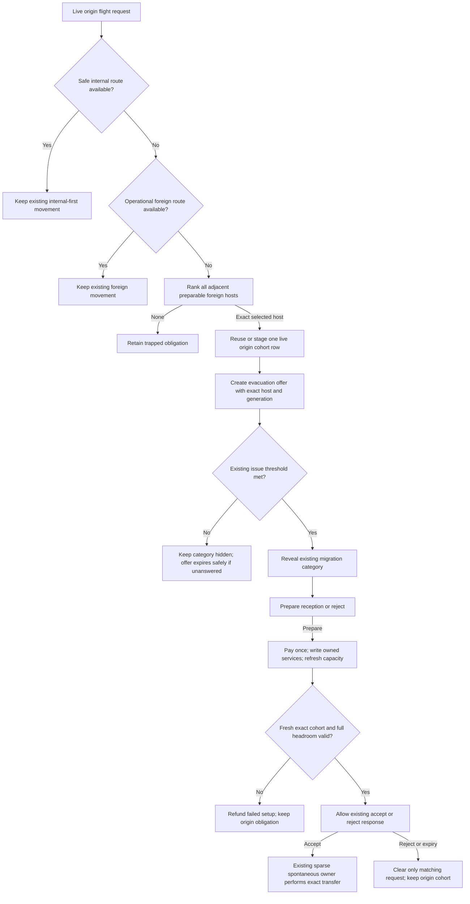

# Prospective reception-request lifecycle plan

Date: 2026-10-03.
Disposition: accepted and queued by the parent for implementation review on 2026-10-03.
Acceptance basis: parent review within the original user-authorized famine/migration goal chose a real prospective reception-request lifecycle tied to a live origin cohort and an exact adjacent host, with paid shelter and medical preparation through existing owners.
Implementation is in progress and remains incomplete; this plan does not claim the host lifecycle is implemented.

## Scope and binding boundaries

Keep famine and migration as separate mechanics with their existing `famine_decision_category` and `migration_decision_category`, their three canonical values each, and the two state mapmodes available from campaign start.
Use only `migration_*` ownership plus the existing narrow `humanitarian_*` corridor contract and `civilian_transfer_*` transaction.

Do not create an event ID, event object, event-pool entry, pacing pulse, category, tab, mission family, GUI, mapmode, asset, stockpile, service baseline, or population-transfer ledger for this request.
Do not use native infrastructure or population as proof of shelter, medical service, reception capacity, or an operational route.
Do not change physical population, bind the cohort destination, or update state/country reception load until the existing exact transfer transaction succeeds.

The request lifecycle must preserve internal-safe destination priority, normal destination safety and policy rules, and all existing route, actor, cohort, hazard, and transfer proofs.
The preparable state may omit only current paid reception capacity and service readiness; the actual offer acceptance and subsequent transfer remain gated by current capacity, current policy, the exact positive live cohort, route proof, and exact host identity.

Design inputs read: `famine_and_migration_system_spec_part_3_displacement_migration_return.md` (destination selection, border policy, exact transfer, reception capacity, and destination actions); `famine_and_migration_system_spec_part_6_decisions_ai_presentation.md` (category lifecycle, destination decisions, costs, AI goals, and presentation limits); `famine_and_migration_system_decision_map.csv` rows `migration_open_reception`, `migration_negotiate_corridor`, and `migration_evacuate_vulnerable`; `famine_and_migration_system_integration_matrix.csv`; `famine_and_migration_system_probability_scenarios.csv` named cases below; `famine_and_migration_system_decision_mission_prompt.md`; `famine_and_migration_system_coding_prompt.md`; and `famine_and_migration_system_goal_prompt.md`.
The two source handoffs read were `normal_destination_bootstrap_audit_20261003.md` and `normal_food_observation_implementation_20261003.md`.

## Source-proven deadlock

The food-observation handoffs close only the independent first-food-assessment gap.
They do not establish shelter or medical receipts, and they correctly leave dormant-host activation unresolved.

`migration_open_reception` in `common/decisions/migration_decisions.txt` is hidden while any `humanitarian_corridor_offer_pending` flag exists and otherwise requires `migration_decision_active` plus `migration_displacement_country_active`.
Its selected-state gates require a current safe food receipt before it can install the first explicit shelter and medical services.

`humanitarian_corridor_prepare_contract` and `humanitarian_corridor_front_destination_is_safe` in the corridor effects and triggers require `migration_reception_capacity_is_valid` and current spare capacity before `humanitarian_corridor_submit_offer` can create the host mirror.
The host therefore has no pending contract that can reveal its paid preparation action until after the capacity that action is supposed to establish already exists.

`migration_reception_candidate_is_valid` in `common/scripted_triggers/migration_core_triggers.txt` requires a valid food receipt, safe food stage, registered candidate, positive state population, positive proven shelter service, and positive proven medical service.
`migration_reception_capacity_is_valid` additionally requires a clean current country revision, positive capacity, at least one safe candidate, and zero invalid candidates.
No normal-country native state or country value satisfies the missing shelter and medical owner receipts.

The ordinary spontaneous movement owner already derives a people-denominated request from current state population and flight pressure, clamped above a protected origin floor.
When its internal-first and foreign-safe destination selector returns no operational destination, it adds only the missing trapped-pressure amount and records a closed-border rejection only when policy alone blocked one otherwise valid host.
It does not create a cohort on that failed-selection branch, so the prospective request must reuse or stage one exact current-host row through the existing cohort owner and must reconcile its retry/abort lifecycle.

There is also an actor-scope hazard in that branch: the registered-state processor runs with a global host in `ROOT`, while the spontaneous owner saves the real acting country as `migration_spontaneous_origin_owner`.
Corridor requester identity, relation checks, host mirrors, and request ownership must use that saved country target or an equally explicit validated request input, never the ambient `ROOT`.

## Intended lifecycle

The normal destination selector runs first and keeps its existing safe-internal preference and foreign fallback.
Only when it returns no operational route may a bounded second pass consider adjacent foreign hosts that are safe and service-preparable.
The second pass must be complete for all eligible adjacent states; it must not select the first neighbor, fail merely because multiple safe hosts exist, or scan all world states.
The automatic spontaneous lane is completed by the existing sparse owner after host acceptance; it does not wait for a manual paid organized-evacuation decision.
The separate manual `migration_negotiate_corridor` lane retains its current decision-owned behavior.

Reuse the existing `migration_destination_selection_calculate_candidate_weight` relation, food, hazard, and ideology score terms for this preparable pass.
Keep existing tuning constants unchanged.
Apply the capacity-available or headroom term only when a current proven capacity receipt exists; a state missing paid services gets no synthetic positive capacity score.
Write the exact drawn state to the existing `humanitarian_corridor_front_state_request` input before preparing the corridor contract.

## Implementation surfaces and exact identifiers

| Surface | Existing source and identifiers | Bounded implementation direction |
| --- | --- | --- |
| Spontaneous movement owner | `common/scripted_effects/migration_spontaneous_movement_effects.txt`: `migration_spontaneous_movement_calculate_request`, `migration_spontaneous_movement_mark_attempt`, `migration_spontaneous_movement_trap_request`, `migration_process_spontaneous_movement_owner`; paired trigger `migration_spontaneous_movement_state_is_ready` | Preserve the live-population request formula and protected floor. After the existing internal-first/foreign-safe selection fails, run one bounded adjacent preparable-host pass. Reuse the real current-host cohort row when one already exists; otherwise stage at most one row with `migration_record_displaced_cohort` from that exact positive request, keeping origin and current host at the live source state and destination unbound. Retain the staged row only for a valid prospective request; continue using `migration_abort_staged_cohort_record` for a failed physical transaction. Block retry duplication while a corridor contract is pending and reuse the exact row after rejection or expiry. Once the host accepts, this same registered-state owner calls `humanitarian_corridor_execute_evacuation` for that row and generation; it does not require the player to click an organized-evacuation decision. |
| Destination selection | `common/scripted_effects/migration_destination_selection_effects.txt`: `migration_destination_selection_run_weighted_pool`, `migration_select_general_safe_evacuation_destination`, `migration_destination_selection_calculate_candidate_weight`; paired `common/scripted_triggers/migration_destination_selection_triggers.txt` | Preserve the ordinary pool and ordering. Add a second preparable pass only after the normal selector yields no operational route. Enumerate `every_neighbor_state` from the exact origin state, using human-country validation, real adjacency, owner/controller and relation checks, the current food projection, current native route and hazard facts, and the host's ability to use the existing paid preparation action. Select one exact host using the existing score terms and return its state ID as `humanitarian_corridor_front_state_request`. Do not mutate services, capacity, population, reception load, or policy in either selector pass. |
| Corridor preparation | `common/scripted_effects/humanitarian_corridor_effects.txt`: `humanitarian_corridor_prepare_contract`, `humanitarian_corridor_submit_offer`, `humanitarian_corridor_expire`, `humanitarian_corridor_cleanup`; `common/scripted_triggers/humanitarian_corridor_triggers.txt`: `humanitarian_corridor_origin_is_valid`, `humanitarian_corridor_front_candidate_is_valid`, `humanitarian_corridor_front_destination_is_safe`, `humanitarian_corridor_front_state_is_valid`, `humanitarian_corridor_offer_route_is_valid`, `humanitarian_corridor_offer_request_is_valid`, `humanitarian_corridor_acceptance_is_valid`, `humanitarian_corridor_offer_is_valid`, `humanitarian_corridor_operation_is_valid`, `humanitarian_corridor_route_binding_is_valid` | Add a preparable-front predicate that keeps exact adjacency, exact owner/controller, current food-safe receipt, native rail/bombing state, and all existing persecution, camp, chemical, fallout, outbreak, zombie, and disaster exclusions, while omitting only the current reception-capacity/service gate. Persist the exact selected front, requester, origin owner/controller, live cohort ID, positive current amount, and route generation through the existing contract. The registry caller must submit `migration_spontaneous_origin_owner` as requester identity; existing ordinary decision calls may retain their actor-root input. It must explicitly submit `humanitarian_corridor_operation.evacuation`, the current relation enum, and `humanitarian_corridor_front_state_request`; it must not inherit the helper's default enemy-front relation when any input is absent. Relief contracts do not acquire the migration preparation action. |
| Pending host mirror and acceptance | `humanitarian_corridor_status.offer_pending`; state flag `humanitarian_corridor_offer_pending`; country mirror fields `humanitarian_corridor_offer_origin_state_id`, `humanitarian_corridor_offer_front_state_id`, `humanitarian_corridor_offer_requester_country_id`, `humanitarian_corridor_offer_deadline`, `humanitarian_corridor_offer_operation`, `humanitarian_corridor_offer_cohort_id`, `humanitarian_corridor_offer_route_generation`; decisions `migration_accept_corridor_offer`, `migration_reject_corridor_offer` | Reuse one existing corridor mirror, not a new request registry. Introduce a preparatory-request validity predicate for the category threshold, prepare action, and rejection. Keep acceptance on the operational validity predicate, which revalidates current safety, policy/consent, service capacity, exact live cohort, positive current amount, actor, route, and full request headroom. Clear/acknowledge the host mirror only after the exact matching generation is successfully accepted; a failed or stale acceptance must not clear the request or mark it accepted. On terminal invalidation, clean only the mirror whose route generation matches the origin contract. |
| Reception preparation | `common/decisions/migration_decisions.txt`: `migration_open_reception` at the current migration decision surface; effects `migration_decision_set_policy`, `migration_set_reception_shelter_service`, `migration_set_reception_medical_service`, `migration_register_reception_candidate_state`, `migration_mark_reception_capacity_dirty`, and `migration_recalculate_reception_capacity` | Keep the existing action and service setters. Preserve the normal-phase path and add a narrow visibility/availability exception for an exact, currently valid evacuation preparation request whose stored front equals `FROM`. The action prepares only the requested state and cannot accept or move the cohort. It must be hidden if neither policy nor a proven service amount can change. Recalculate once after both setters; expose acceptance only after the same current offer generation and full amount headroom pass. |
| Capacity and transfer | `common/scripted_triggers/migration_core_triggers.txt`: `migration_reception_candidate_is_valid`, `migration_reception_capacity_is_valid`, `migration_reception_delta_request_is_valid`; `common/scripted_effects/migration_core_effects.txt`: `migration_apply_reception_delta`, `migration_refresh_reception_capacity`; `common/scripted_effects/civilian_transfer_effects.txt`: `civilian_transfer_execute_transaction`; corridor `humanitarian_corridor_execute_evacuation` | Before acceptance and again before transfer, resolve the exact live row and check that current country capacity covers current load plus the row's exact positive survivor request. After transfer, retain the shared transaction as the only physical population owner, then apply the measured survivor reception delta once. Never count the pending amount as a host load. |
| Category lifecycle | `common/decisions/categories/migration_decision_category.txt`: `migration_decision_category`; `common/scripted_triggers/migration_decision_owner_triggers.txt`: `migration_decision_reveal_threshold_is_met`, `migration_decision_problem_is_active`; `common/scripted_effects/migration_decision_phase_effects.txt`: `migration_refresh_decision_phase_from_country`; add `humanitarian_corridor_offer_reveal_is_valid` in `common/scripted_triggers/humanitarian_corridor_triggers.txt` | Remove unconditional category exposure through a raw `humanitarian_corridor_offer_pending` flag. Route the request through the existing phase/reveal helpers and existing thresholds. The new evacuation-offer reveal predicate resolves the exact current origin row and accepts a single request only when its live amount meets `migration_decision_threshold.category_trapped_people` or `category_flight_people`; the existing `category_incidents` threshold or an independent host-country migration problem can also reveal the category. When the host mirror is first created for a valid evacuation offer generation, increment the existing host `migration_incident_count` once and refresh its existing country phase; a replay of that generation cannot increment it again. Quiet food observation never sets these facts. |
| Localisation and paired docs | `localisation/english/migration_l_english.yml`, `localisation/english/humanitarian_cost_l_english.yml`, `common/scripted_localisation/humanitarian_cost_scripted_localisation.txt`, `common/scripted_effects/migration_spontaneous_movement_effects.md`, `common/scripted_effects/humanitarian_corridor_effects.md`, `common/scripted_effects/migration_capacity_effects.md`, `docs/systems/migration_system.md`, `docs/systems/civilian_transfer_system.md` | Keep the existing accept/reject wording that names requester, origin, and front state, and the `migration_open_reception_desc` statement that preparation does not open the route. Add one concise request-specific target/blocked explanation if needed. Correct the spontaneous movement helper documentation so it matches current pre-debit staging and the new retained pending-row branch. Do not add GUI, icon, asset, or workbook work. |

## Exact actor and cohort identity

The source request amount must come from `migration_spontaneous_movement_calculate_request`, which computes a people-denominated value from `state_population_k` and live flight pressure, then clamps it to the live movable population above `migration_spontaneous_movement.protected_origin_share`.
The request may stage only that bounded amount under the existing monotonically allocated `global.migration_next_cohort_id`; it must not use trapped pressure alone as a population amount.

At every reuse, offer, acceptance, and transfer boundary, require aligned cohort arrays, `migration_decision_exact_hosted_cohort_is_valid`, no `migration_cohort_selection_ambiguous`, one current live row at the origin, positive `migration_state_live_cohort_amount`, and exact equality between `migration_current_cohort_id` and the contract's `humanitarian_corridor_cohort_id`.
Resolve the current row again at acceptance and transfer; do not trust the cached `humanitarian_corridor_transfer_people` snapshot if the live row changed.

`humanitarian_corridor_route_generation` is the durable identity for one contract attempt, and the existing host mirror must carry that same generation.
Reuse the cohort ID across a retry, but every new contract attempt after rejection, expiry, or invalidation must run `humanitarian_corridor_prepare_contract` and allocate a fresh monotonic route generation.
Never revive a terminal generation or reuse its offer nonce.
Use the source's allocated cohort ID for cohort identity.
Use `migration_flight_request_generation` only when the owner supplied it; ordinary spontaneous request input does not guarantee that optional generation exists.
Do not use `global.date` as a request ID.

The global sparse-state scheduler may run with a host country in `ROOT`.
The spontaneous owner already saves the actual origin owner as `migration_spontaneous_origin_owner`; the preparation call, relation checks, requester-country ID, response mirror, and cleanup must preserve this same actor.
Never let a global-host `ROOT` become the origin requester or determine war/faction relations.

## Player-facing response and category budget

The existing migration category keeps Displacement Load, Reception Capacity, and Border Policy as its only three canonical values.
The existing compact report header remains unchanged.
This request does not create a fourth status value, extra meter, category, tab, or GUI.

During a revealed preparation request, the pending phase shows the existing `migration_open_reception` preparation action and `migration_reject_corridor_offer`; `migration_accept_corridor_offer` remains hidden until the offer is operationally valid.
After a paid preparation succeeds, the action set shifts to existing accept/reject responses.
This is at most three primary actions and creates no new mission.
The existing `migration_mission_hold_humanitarian_corridor` remains the only corridor mission, with `migration_mission_timing.secure_corridor_timeout` at 120 days, exact finalized-operation success, and its existing timeout consequences.
It already respects `migration_mission_contract.maximum_active_missions = 3`; no new mission or duplicate objective is proposed.

Do not reveal the host category for a quiet food observation or one tiny positive pending row.
Use `migration_decision_threshold.category_incidents = 2`, `category_trapped_people = 1000`, `category_flight_people = 5000`, and `category_reception_load = 5000` through the existing decision-phase helpers.
A pending offer is one source of issue evidence only when it independently meets an existing large threshold, represents a repeated issue, or occurs in a country that already has a material migration problem.
The ordinary first small offer may expire unseen; its source cohort and trapped obligation remain intact.

## Costs, requirements, and localisation

`migration_open_reception` currently spends exactly three resource types: 20 political power, 100 support equipment, and 500 fuel.
Its cost row uses `GetHumanitarianCostPp20Cost`, `GetHumanitarianCostSupport100Cost`, and `GetHumanitarianCostFuel500Cost`; the existing English ready/blocked strings use `£pol_power`, `£support_equipment_text_icon`, and `£GFX_fuel_texticon`.
No fourth cost is hidden in the action.
`num_of_civilian_factories > 0`, controlled safe state, food safety, route infrastructure, policy, and hazards are requirements, not consumed costs.

The current affordability checks use strict `>` at the nominal amount, so exact nominal holdings fail the cost gate, and `available` does not share an inclusive predicate with `custom_cost_trigger`.
Define one shared inclusive `migration_open_reception` affordability helper using existing constants and call it from both blocks and the ready/blocked cost selectors.
Keep exactly one debit in `complete_effect`.
Do not duplicate costs in the request tooltip.

Before any debit, revalidate exact offer generation, exact host state and controller, current food/hazard proof, positive service request, and affordability.
Require the paid action to increase at least one existing shelter/medical service amount or change the reception policy; an identical already-paid receipt is not a successful setup and must not be charged again.
After the single debit, call the two existing service setters and one capacity recomputation.
If either setter rejects, the generation changes, or the resulting current revision cannot accept the full exact cohort, refund political power, support equipment, and fuel once and roll back only service and policy changes newly written by this click.
Preserve older service receipts.
If paid services and policy are successfully installed but the host later rejects or the offer expires, those paid services remain as real country infrastructure and no cohort transfer or reception load is recorded.

The current open-reception title and description already explain that services are funded for the selected safe state and that preparation alone does not open a movement route.
Use the existing target tooltip for safety requirements and add a short dynamic origin/front explanation only if the state-target row does not make the exact request clear.
The existing accept/reject titles name the requester; their descriptions name origin and front and make clear that acceptance authorizes a route but does not move civilians.

## Actual capacity and service gates

The current `humanitarian_corridor_front_destination_is_safe` test only requires `migration_reception_load < migration_reception_capacity`, which proves some spare capacity, not enough headroom for the named cohort.
`migration_reception_delta_request_is_valid` accepts a positive credit without checking the post-credit load against capacity.
`humanitarian_corridor_execute_evacuation` resolves and transfers the full current row, so this gate must use the same full resolved amount, not a smaller stored offer snapshot and not a silently clamped partial amount.
For this lifecycle, add one exact-request guard before acceptance and transfer: after resolving the live row, prove `current reception load + exact current transfer amount <= current valid capacity`.
If the row amount changed after offer preparation, invalidate that offer and prepare a new generation using the re-resolved row amount before acceptance.
Keep the country revision current and non-dirty, the host candidate safe, the reception policy open or the exact corridor acceptance policy receipt valid, and all existing food, route, actor, and hazard proofs.
This narrow request guard prevents a whole cohort from being admitted merely because one person of headroom exists; it does not retune global capacity.

The existing capacity calculation clamps medical quality to `migration_capacity.medical_quality_floor`, while the normal paid reception action submits a positive population-scaled medical service receipt through `migration_set_reception_medical_service`.
This plan makes no medical-floor or service-share tuning change; any broader quality-floor review remains separate.

## Lifecycle, cleanup, and exploit controls

There may be only one pending corridor offer per host, as enforced by the existing `humanitarian_corridor_offer_pending` guard.
Reuse the same cohort row after rejection or expiry, but allocate a fresh monotonic route generation for each newly prepared contract attempt.
Count each successfully submitted, valid evacuation offer once in the existing `migration_incident_count` for its new route generation, then call `migration_refresh_decision_phase_from_country` on the host.
The existing pending-contract flags and generation guard prevent a replay from counting the same offer twice; no new meter or counter is added.
This lets two distinct small requests reach the existing `category_incidents = 2` threshold while the first tiny request alone remains hidden.
This is migration-local reveal evidence only; it must not call event-log, random-event, pacing, or event-category surfaces.
The spontaneous owner must not replay the ordinary transfer branch while that exact row has an active pending corridor contract.
When the corridor is rejected or expires, a later spontaneous pass reuses that same row and its live amount rather than appending a duplicate.
If the row's current amount, origin, owner, or status cannot be re-resolved, keep the transfer and offer unavailable until the existing migration reconciliation or cleanup owner resolves it.

Rejection or response timeout clears the matching corridor state and country mirrors but leaves the live origin cohort, source population, and trapped obligation unchanged.
Successful acceptance clears the host offer mirror only after the exact current generation and `humanitarian_corridor_acceptance_is_valid` both succeed.
The present acceptance effect clears host mirrors outside its inner successful-acceptance branch; move those clears inside a successful acknowledgement or route them through exact terminal cleanup when the offer is invalid.

Revalidate the exact origin and front on the existing state-control, war, peace, annexation, and route-owner callbacks.
Cancel only the stale route contract when host identity, controller, route, cohort, or generation is invalid; preserve the source row and re-request obligation when people still live at origin.
Country cleanup must compare the mirrored `humanitarian_corridor_offer_route_generation` to the origin `humanitarian_corridor_route_generation` before clearing a mirror, so a stale callback cannot clear a later offer.
Use existing `humanitarian_corridor_timing.offer_response_days = 10`, response-decision days of 3, and re-enable days of 1; do not add another timer or recurring action.

Retain the migration scheduler's sparse registered-state and registered-country bounds.
The preparable pool may iterate only `every_neighbor_state` from the current live origin state.
Do not add a global state/country scan, new on-action, or periodic host discovery.

## AI and probability requirements

No numeric AI weights or tuning constants are selected or changed by this plan.
Preserve the current `migration_decision_ai` and `humanitarian_corridor_ai` values and make human and AI share the same exact availability and payment gates.
The host AI may pay to prepare only when the exact request is current, the action can change a service or policy, and all three costs are affordable.
The host AI may accept only when the request is operationally safe and full request headroom is proven; it may reject a valid preparatory request without deleting the source obligation.

The source-weighted candidate set changes when preparable neighbors become candidates, so it requires a frozen pre-edit source, named baseline, owner-applied source patch, and `hoi4.probability_compare` through `chaosx_ai_probability_auditor` using the same scenario set.
Existing relevant scenario IDs are `prob_corridor_acceptance`, `prob_humanitarian_border`, `prob_capacity_exhausted_border`, `prob_destination_selection_internal`, and `prob_destination_selection_persecution` in `famine_and_migration_system_probability_scenarios.csv`.
The owner should add a source-backed normal-neighbor/preparation case before implementation review; no typed fixture fields may be invented if the installed probability schema rejects them.
The weighted analysis must state whether every candidate and external factor is present and keep willingness scores separate from click probabilities.

Read-only source inventory from the probability subagent found `migration_negotiate_corridor` uses existing score constants `migration_decision_ai.negotiate_corridor_base` and its two factors; `migration_accept_corridor_offer` and `migration_reject_corridor_offer` use the current `humanitarian_corridor_ai` accept/reject bases and modifiers; `migration_open_reception` uses its existing `migration_decision_ai.open_reception_base` and three factors.
No MCP probability artifact or ranking is available yet.
The auditor's first decision `hoi4.probability_inspect` timed out after 600 seconds; its narrower retry returned `JOB_WORKER_FAILED` / “The isolated worker stopped without publishing a result,” with zero artifacts and no diagnostics.
The separate `custom_weighted_pool` inspection for `migration_destination_selection_effects.txt` also timed out after 600 seconds with no artifact or analysis ID.
The complete pool cannot be built from the scenario CSV alone because current selection dynamically filters neighboring states by owner/controller, route, food, hazards, border policy, capacity/load, and hosted-cohort history.
Baseline findings remain unresolved; the source-only score inventory is not a ranking or probability result.

## Parent-owned acceptance scenarios

1. A healthy internal neighbor remains preferred and the spontaneous request path is never selected while an operational safe internal destination exists.
2. A normal spontaneous cross-border request with a real positive live origin row and two or more adjacent safe preparable foreign states selects one exact state through the complete second pass, records its owner/controller and relation, and creates no service, transfer, or host load.
3. A food-unsafe, rail-damaged, recently bombed, persecuted, camp, contaminated, fallout, outbreak, zombie, or disaster-affected adjacent state is never selected for preparation.
4. A host missing either shelter or medical proof receives only the exact request mirror; the migration category remains hidden unless the existing large/repeated/sustained thresholds are met.
5. A host at exactly the nominal cost amounts can take `migration_open_reception`; each resource is debited once, service setters return valid receipts, and capacity is recomputed from the current candidate registry.
6. An unaffordable or stale request shows the correct blocked cost or request reason; a post-debit service failure refunds all three costs and leaves no new service proof, policy change, transfer, arrival, or load.
7. Acceptance is unavailable until current food, safety, policy, route generation, cohort row, positive amount, and full current capacity headroom pass.
8. Host acceptance changes corridor status only; the existing migration evacuation action then performs one exact transfer and measured reception update.
9. Request rejection, ten-day expiry, host control/owner change, annexation, route loss, save/reload, closed-border policy, and duplicate submit all preserve the real origin obligation and cannot clear a newer generation's host mirror.
10. A tiny first incoming request alone does not reveal the category; a request over the accepted threshold or repeated valid offers use the existing phase helper without creating a new category or counter.
11. A relief-only corridor offer does not gain the evacuation preparation button through this change; its existing category/reveal exposure is tracked as a separate owner cleanup.
12. The existing `migration_mission_hold_humanitarian_corridor` starts only after actual transfer/relief proof as already wired, remains capped by the existing three-mission limit, and cannot be duplicated by a pending request.

## Validation limits and remaining blockers

This assignment changed only the two planning documents listed in the handoff.
No gameplay source, localisation, GUI, assets, mapmode, workbook, or probability source was edited.
No game was launched, no logs or save were read, and no source tests were run.

Offline installed decision documentation and the offline Decision modding page were read directly for targeted-decision evaluation cadence, `target_array`, and the cost/target scopes.
The installed documentation warns that `visible` and `available` refresh every frame and that unbounded `state_target = any` checks every state; the bounded plan uses the existing sparse state owner and its `every_neighbor_state` domain.
The narrow live `hoi4.reference_context` and `hoi4.decision_inspect` calls were initially rejected for a question over 160 characters and missing required scenario input, respectively; corrected requests with a short question and named source-only decision scenario each timed out after 600 seconds without artifacts.
No live decision or engine execution evidence is claimed.

The exact-capacity headroom guard is source-proven and directly required by the accepted reception contract, but its implementation and same-scenario probability comparison remain parent-owned.
The spontaneous helper documentation currently says cohorts are recorded only after positive survivor credit, while source stages a row before the physical debit and aborts that staged row on failed transfer; implementation must reconcile that paired documentation and preserve the new pending-row state deliberately.
The generic corridor offer surface also supports `humanitarian_corridor_operation.relief`; relief-only category exposure is a separate cleanup and must not be silently pulled into this evacuation repair.
