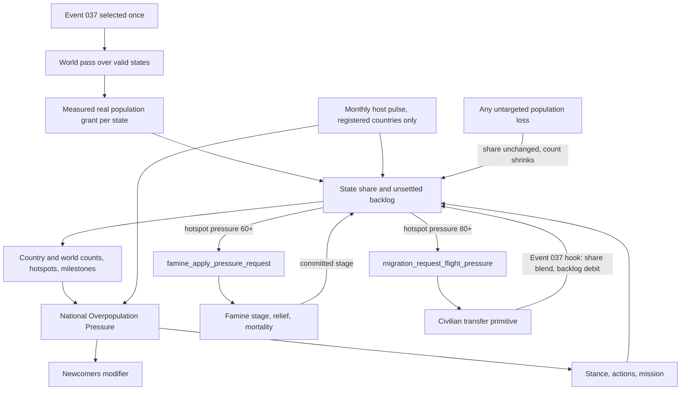

# Event 037 system flow

## Runtime flow



## Ownership

| Fact or action | Owner | Event 037 role |
| --- | --- | --- |
| Population creation at a manifestation | Event 037 | Create once through the neutral gain helper |
| Newcomer share and unsettled backlog | Event 037 | Store per state |
| Overpopulation Pressure and the Newcomers modifier | Event 037 | Compute and apply |
| Food values, stages, relief, famine deaths | Famine | Submit one need component per crowded hotspot |
| Cohorts, routes, borders, reception, route deaths | Migration | Request flight from Breakdown hotspots |
| Physical moves and conservation | Civilian transfer primitive | One finalization hook |
| Deaths and Chaos from deaths | Owner of each cause | None |
| Special and nonhuman eligibility | Shared civilian classifiers | Call `humanitarian_state_is_valid` |
| History and evolution logging | Event Logs | One firing row and evolution rows |

## Invariants

```text
state population after grant = state population before grant + measured grant
newcomers in a state = newcomer share x live state population
0 <= unsettled newcomers <= newcomers in the state
```

A grant never repeats for one firing identity, and no Event 037 step removes population.
