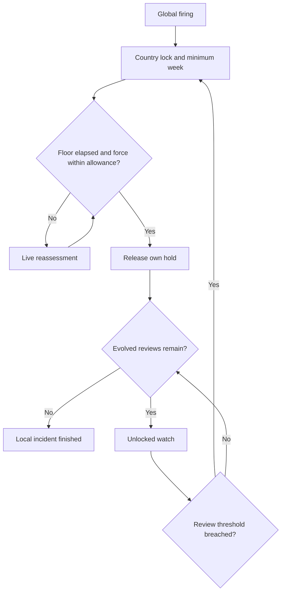

# Event 096: core experience and lifecycle

Proposed design: [README](README.md#authority-and-current-workflow) records current authority, owner workflows and historical receipt limits.

## 1. The disruption

Every existing country receives the native country-wide division-template lock at the same logical firing.
Its deployed land formations keep their current orders, fronts, location, experience, strength, and organization.
Event 096 does not disband, move, consolidate, or damage a formation at entry.

Each country is assessed against its own current national capacity.
An industrial great power can support a much larger force than a small state.
A country with extensive but sparsely populated land gains some capacity from territory, while population and industry remain substantial contributors.
Losing a productive region can turn a previously reasonable army into a serious excess.

The player follows two quantities: the country's weighted fielded force and its live allowance.
The strategic choice is whether to keep that army, voluntarily remove randomly selected eligible formations, or grow the country enough to support it.
Construction, conquest, population changes, and other events enter through the same capacity calculation.

The native operation is `country_lock_all_division_template = yes`.
The current offline effect description also associates it with preventing training and ordinary disbanding.
Presentation must accurately describe the installed build's actual behavior.
Scripted army grants and existing special recruitment exceptions must be measured when they occur, without rewriting those providers' rules merely to make the event more restrictive.
See research records R01, R03, and R06.

## 2. One precise release rule

For country c, let F be current weighted force, A its current allowance, t the current game day, m the earliest release day, and x the latest release day.

**Release the Event 096 hold when t is at least m and either F is at most A or t has reached x.
Equality qualifies.**

A fresh hold sets m to seven full days after application.
Current situation determines whether the country is still compliant when that floor expires.
Being within allowance on the first day does not reserve a release if its army expands or its capacity falls during the week.

After the floor, compliance ends the Event 096 restriction at the next authoritative local refresh, normally within one game day.
A successful demobilization transaction refreshes immediately.
The implementation must not require an acknowledgement, a political-power payment, or a later inspection appointment to release an already compliant country.

### The proportional extension

The brief asks both for extensions proportional to excess and for release once the country is within its allowance.
Compliance is the normal release, and a finite cap makes the extension proportional even when nothing changes.

At lock, record the excess e = F / A - 1 (zero when F is at most A).
The latest release day is x = lock day + 7 + ceiling(60 × e) days.
A 10 percent excess therefore waits at most 13 days, a 50 percent excess at most 37 days, and a doubled army at most 67 days.
Demobilization or capacity growth still releases sooner, at the first refresh after the seven-day floor where F is at most A.
A re-application to an already locked country keeps the later of the existing and newly computed latest release days.
The cap is fixed at lock: later army growth does not extend it, and later losses do not shorten it.

Basis: orchestrator acceptance on 10 October 2026 of the audit proposal, within the user's planning-package brief.

The hold interface shows two facts: whether the country is within its allowance now, and the latest release day.
Do not add a hidden accumulating debt, automatic allowance inflation, or an automatic disband.
Do not present time to the next evaluation as time to unlock.

## 3. Country lifecycle

| State | Mechanical behavior | Player information | Exit |
| --- | --- | --- | --- |
| Fresh lock | Acquire this event's hold, refresh F and A, begin seven-day floor | Both values, whether force exceeds allowance, minimum time remaining | Floor ends or another valid firing renews it |
| Floor running, compliant | Hold remains and values continue changing | Compliance is current, release still conditional on floor | Release at floor if still compliant |
| Floor running, oversized | Hold remains, optional reduction actions can be used | Current deficit is explained qualitatively from F and A | Become compliant or reach the end of the floor |
| Floor elapsed, oversized | Hold persists without a terminal date | Both values and the two ways to resolve it | Fresh calculation proves F at most A |
| Released | Clear only this event's hold | Local result and any other owner still preventing editing | Close locally at base and Evolution I, or enter an evolved watch |
| Evolved watch | Templates are free of this event, a bounded future review remains | Both values and next review time | Pass, relock, or use the remaining review budget |
| Finished | Stop this country's callbacks and hide the temporary category | Durable history remains available through existing logs | A later genuine firing or an applicable active evolution |

The diagram's return from a failed review starts a new local seven-day floor.
It consumes an existing review, rather than creating another review allowance.

## 4. What changes the outcome

| Change | Intended effect |
| --- | --- |
| More deployed battalions or support attachments | F increases according to structure and type |
| The same battalions rearranged among fewer divisions | F remains the same |
| Combat damage, low organization, missing equipment | F does not fall just because an existing structure is depleted |
| A formation actually disappears | F reflects the surviving fielded structure on refresh |
| Controlled territory and its population are gained | A increases under the territorial access policy |
| Controlled territory is lost | Its contribution leaves A |
| Domestic industry grows or is permanently removed | A rises or falls |
| A combat-stat advantage from another event | No direct change to A or F |
| Population changes through another event | A follows the live population value |

Ordinary battle losses can change the surviving structure if a whole unit is destroyed, but Event 096 never creates casualties to produce compliance.
Its Chaos accounting must not count generic war deaths a second time.

## 5. Simultaneous global start, independent resolution

The global entry enumerates every real existing country once, including human countries, AI countries, subjects, exiled governments that remain valid game actors, and special Chaos countries.
There is no nationality list and no exemption merely because an army uses robots, rats, undead troops, or another unusual force.

Dormant possible tags that are not game actors do not receive scheduled work.
A valid country with no deployed army is still locked for the minimum week, then satisfies the force test.
It does not need to create an army to complete the event.

Each country owns its calculations, minimum date, review state, and actions.
One giant country remaining oversized does not prevent every other country from unlocking.
Event 096's global director stays alive only while a participating country's lock or evolved watch remains active.

The firing cohort is fixed.
An unrelated country created after entry waits for a future global firing.
A political successor or splinter inheriting the forces or institutions of an active participant inherits the applicable inspection obligation instead of using tag creation to escape it.
An active hold transfers as a hold, with a fresh measurement and a seven-day floor on the successor's own first application.
An unlocked watch transfers as an unlocked watch with its original absolute due day, remaining credits, and consumed review receipts.
Succession alone neither relocks a watched country nor grants a fresh delay.
An overdue transferred review resolves once on the next authoritative local evaluation.

Parts 4 and 5 define split and merge rules that preserve credit history and relapse-counted status.
They never transfer a pending destructive authorization or an unfinished achievement attempt to a different actor.
A release from an already finished participant does not resurrect an old incident.
Cosmetic tag changes and control handovers preserve the operational country episode, with authority and achievement eligibility still checked separately.

This succession rule requires an actual source and successor relationship.
Do not infer it from neighboring land, original-tag similarity alone, or the existence of any global incident elsewhere.

## 6. Repeat firing

Every genuine firing refreshes every current country's F, A, and applicable evolved regime from the live world.
An already locked country keeps its hold and sets its earliest release to the later of the existing floor and seven days after the new application.
A released country starts a fresh hold.

Overlapping firings coalesce local work.
They do not stack separate native locks, duplicate daily callback chains, add batches of inspection credits together, or queue repeated identical reports.
The new grant replaces the current inspection target through the maximum rule in Part 4.
A renewed floor can extend the restriction, but repeating a calculation itself grants no extra Chaos.

A genuine new picker dispatch is distinct from duplicate delivery of the same dispatch.
Preserve the existing fired-handler and event-log contract.
Log one canonical global manifestation per dispatch, not one manifestation per affected country.
Duplicate delivery of the same dispatch is idempotent.

Pending disband confirmations become invalid when a firing supersedes their inspection context.
Their stored request is retained as an invalid receipt until its native popup terminates.
A later request must not overwrite a slot still readable by an older popup.

## 7. Player outcomes and endings

The ordinary successful ending is administrative release, reached by force reduction, capacity growth, or a mixture of both.
It restores only the editing rights this event owns.
If another system still owns the country lock, the local result must distinguish Event 096 compliance from actual editing availability.

Keeping an oversized army is a complete supported strategic outcome.
There is no compulsory terminal punishment and no forced surrender or peace treaty.
A country may remain locked for a very long time, including beyond the end of every other participant's incident.

Annexation ends local scheduling for the vanished country.
It is neither compliance nor achievement success.
An inheritor is assessed under the succession rule.
Disabling future Event 096 firings prevents new dispatches but does not silently forgive active holds.
If the project has an explicit clear-active-effects operation, it releases this event's holds and watches, invalidates requests, grants no completion reward, and preserves every other lock owner.
