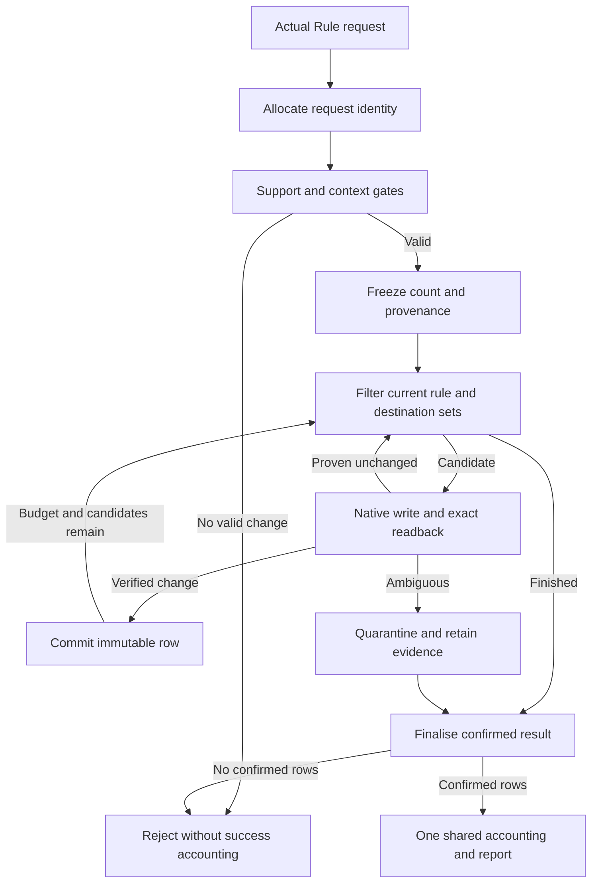

# Event 104 Rule: implementation handoff

## Implementation order

This imported technical contract is a future implementation input, rather than permission to change gameplay.
Use accepted planning IDs 104 Rule and companion 105 Random Idea under the user's 10 October 2026 choice recorded in [source and authority](104_rule_source_and_authority.md#status-and-authority).
Other acceptance issues remain open, and catalog migration is queued for later authorized catalog work with 107/110 held as legacy identities unavailable for reuse.
The proposed 60 percent participation below remains unresolved pending parent acceptance, and Medium membership denotes severity rather than a selection percentage.

Resolve the native mutation proof gate before building gameplay around an assumed writer.
Then build the admitted rule registry and verify representative directed transitions.
Implement the event-owned mutation and receipt lifecycle, integrate the shared dispatcher and presentation, add evolutions and Chaos accounting, wire the campaign consumers and achievements, and finish assets, localisation, catalog alignment, and acceptance evidence.
Registration and default availability must not expose a partial event.

This document specifies responsibilities and state semantics.
Names presented as proposed paths or helpers are new work targets, not assertions that they exist.
Exact engine fields must be confirmed against the installed documentation.

## Proposed event-owned file surfaces

| Surface | Proposed path or owner | Responsibility |
| --- | --- | --- |
| Event roots and notifications | `events/104_rule.txt` | `chaosx.nr104.1`, receipt-bound reports, and narrowly required lifecycle callbacks. |
| Core effects | `common/scripted_effects/104_rule_effects.txt` | Preparation, bounded application, readback, commit, result construction, and cleanup. |
| Core triggers | `common/scripted_triggers/104_rule_triggers.txt` | Pure availability, admitted transitions, meaningful witnesses, prefix-preserving compatibility, and challenge conditions. |
| Constants | `common/script_constants/104_rule_constants.txt` | Stable event, stage, row, option, count, timing, Chaos, and achievement tuning. |
| Dynamic MTTH values | Existing appropriate `common/mtth` surface or `common/mtth/104_rule_mtth.txt` | Supported dynamic evolution parameters. Choose one owning location and document it. |
| Localisation | Existing language structure with an Event 104 file | Final writing for reports, tooltips, history, evolution previews, and achievements. |
| Achievement source | Current shared achievement owner | Three stable IDs and bounded tracking hooks. Do not invent a second achievement framework. |
| Runtime art | Paths in Part 6 | One report texture and nine achievement state textures. |
| Durable event documentation | `docs/events/` according to current repository convention | Actual behaviour, native support matrix, receipt lifecycle, and completed validation evidence. |
| Accepted spec location | `docs/specs/104_rule_specs/` | The package's design and handoff files. |
| Implementation work plans | `docs/plans/104_rule_plans/` | Evidence-bound plans, unresolved findings, and disposition records. |

## Shared integration surfaces

| Shared owner | Required change |
| --- | --- |
| `chaosx_logic_effects.txt` | Register 104 as Minor Repeatable when ready, preserve category resolution and weight/cap bounds, and guarantee one successful handler invocation per committed occurrence. |
| `chaosx_settings_effects.txt` | Add a Rule-specific pre-fire path that performs verified mutation before successful accounting, then dispatches the receipt-bound root. |
| `chaosx_settings_triggers.txt` | Current availability, explicit default-enabled decision at completion, disabled-event behaviour, and shared evolution gates. |
| `chaosx_events_log_effects.txt` and corresponding localisation/getters | Bind immutable Rule payloads, truthful global actor treatment, existing history detail, and evolution records. |
| Existing cluster registry | Add Rule to the actual Randomizations cluster at Medium role, with correct type, unlock, participation, cooldown, and single-burst pacing semantics. |
| Existing global lifecycle route | Evaluate the four active evolution gates once per global interval and preserve executor continuity without adding all-country periodic scans. |
| Existing affected campaign systems | Revalidate real rule-governed actions and close impossible pending tasks through their own receipts and lifecycle contracts. |
| Existing achievement system | Subscribe to Rule receipts, war and faction outcomes, player continuity, and generation-bound deadline checks. |
| Authoritative workbook | Reconcile user-accepted 104 identity and companion references, update exact approved mirror text, and export CSVs through the required script. |

The supplied cluster catalog places Randomizations at 14, while older repository plans have proposed other IDs.
Resolve the real workbook and registry identity before using a numerical constant.
Use a stable symbolic cluster reference in new code.
Do not create a duplicate Randomizations cluster or remap an unrelated cluster from a remembered number.

The requested Medium membership does not by itself provide a verified participation percentage or cluster cooldown.
Use the current accepted Randomizations member policy if present.
If those values are undefined, the proposed starting participation is 60 percent for this optional member, subject to the full-cluster probability review and parent acceptance before implementation.
The automatic route respects event eligibility and current evolution settings.
The manual route can bypass only the restrictions the shared force contract explicitly allows.

## State contract

| State family | Durability and ownership |
| --- | --- |
| Native selected options | Native engine authority. Read before every draw and immediately after every write. Never replace with event shadow state. |
| Registry schema | Durable version and stable native-key mapping. Migration cannot reinterpret reused numeric row indices. |
| Request identity | Durable increasing campaign counter, including IDs consumed by rejected or quarantined requests. Never use game date as identity. |
| Touched membership | Durable per-native-rule provenance set after a verified successful Event 104 change. |
| Destination visits | Durable rule-and-option novelty records. Renaming a row must not reset credit. |
| Previous successful batch | Stable native identities of confirmed committed rows from the latest successful occurrence. |
| Evolution state | Unlocked flags, recorded state, and required MTTH lifecycle support, separate from current enable toggles. |
| Receipt header | Request identity, source route, sampled Chaos, active capabilities, initial fresh/revision provenance, requested count, actual counts, date, status, and accounting receipt. |
| Receipt rows | Stable native identity, actual old and new option, ordered position, fresh or revision classification, meaningfulness witness summary, and raw Chaos eligibility. |
| Presentation state | Verified immutable payload reference or per-recipient pinned receipt, queue, acknowledgement, and generation state. |
| Quarantine | Durable unresolved request and native-readback evidence, with writes disabled until verified reconciliation. |
| Achievement attempts | Shared player-country ownership, start snapshot, qualifying receipts, result evidence, deadline generations, and disqualifiers. |

Use flags for booleans, supported variables for quantities, and the engine's documented collection mechanisms for identity sets.
Where native string-valued dynamic lookup is unsupported, generate literal per-rule branches with stable constants.
Do not invent a generic string setter or a block-parameter scripted-helper API.

Temporary values have explicit invalid sentinels and caller-owned lifetimes.
Allocate every public temporary output in the caller before the helper call, including outputs forwarded by nested helpers.
Reset outputs at helper entry and clear one-shot inputs on every exit.
Do not clear a published output before its caller consumes it.
ROOT remains its original scope when entering another country, so pass and validate subjects explicitly.

## Pure availability versus mutating preparation

The ordinary availability check is read-only.
It confirms that Rule is enabled, supported, not quarantined, and has at least one admitted meaningful destination under the applicable capability rules.
It does not consume random numbers, mark touched rules, start an achievement, reserve a receipt, award Chaos, or mutate any native option.
The shared event-pool evaluator may call it repeatedly without changing the campaign.

The actual dispatch preparation is the single mutation owner.
It runs only after the shared system has chosen or legitimately requested Rule.
Allocate the request identity at this actual request entry before any preparation gate can reject it.
Passive repeated availability evaluation is outside that request lifecycle and allocates no identity.
It then snapshots the count profile and initial provenance, performs the bounded selection process, verifies native writes, and builds the immutable result.
The root event is a consumer of that result rather than a second mutation entry point.

Directly triggering `chaosx.nr104.1` without a valid committed receipt must not reroll or apply rules.
It should reject through the appropriate debug or diagnostic handling without claiming a normal occurrence.
Expose a supported manual request path through the shared dispatcher for development and authorised force use.

## Authoritative transaction sequence

The rejection label in the diagram does not erase an incident receipt.
An ambiguous zero-confirmed request retains its quarantine and uncertainty rather than asserting unchanged world state.
The bounded loop tracks every attempted native identity, including definite no-ops, and cannot retry it within the request.

Before each draw, apply the current category priority, recency stratum, per-rule destination filter, and prospective compatibility predicate.
Draw a rule uniformly, then draw a destination uniformly from that rule's filtered set.
Validate all known native options so readback resolves to exactly one current value.
Count success only when the intended destination is active and the distinct previous option is no longer active.

Commit each successful row and its provenance before moving to the next attempt.
At request completion, use the actual confirmed subset for counts, history, achievements, and Chaos.
No fictitious rollback is assumed.
A definite zero-success request cannot enter `on_repeatable_event_fired`.

## Accounting and reentry

Prepare the immutable history payload before invoking the shared successful-firing handler.
The handler can synchronously attempt Random Stuff after recording the first history row.
The Rule result therefore cannot be reconstructed later from `global.last_fired_event_id` or a single mutable last-result array.
Record a per-receipt accounting acknowledgement so a duplicate root, callback, or presentation delivery cannot charge the occurrence twice.

Clear or release the short synchronous execution guard at the point permitted by the proven dispatcher order, while keeping the completed receipt immutable.
Do not hold an execution guard while waiting for a human acknowledgement.
A subsequent legitimate request can mutate the world before the previous report is read.
Cleanup must use the completed request identity and cannot erase a newer request's data after a synchronous nested dispatch.

The execution guard is an engine reentry convention, not a claim of operating-system locking or multiplayer safety.
Review host ordering and peer authority against current installed references and source.
Peer convergence remains a user-owned observation when no live evidence is supplied, with its verification limit recorded separately from implementation delivery.

## Evolution scheduling and capability use

Use the shared threshold-aware activation gate for a locked stage's activation and first-time record.
The inspected `is_current_evolution_enabled` helper includes current Chaos, so it cannot by itself define whether an already unlocked stage contributes on a later firing.
That capability check uses the durable unlock and the stage's current enable setting, preserving the accepted sticky unlock after Chaos falls.
Before the first successful occurrence, use Part 3's provisional enabled threshold-eligible opening and commit those unlocks only with a verified successful result.

Master Rule disable pauses active-system MTTH evaluation and new automatic unlock notifications while preserving native changes and existing unlocks.
Resume under current conditions when reenabled, without catch-up draws or backdated guaranteed progress.
An accepted forced request uses its permitted dispatch route and applicable enabled capabilities, including the pre-first-success opening, but does not restart background checks while the master setting is disabled.
Keep these gates separate from the pure availability predicate and from the immutable historical evolution records.

## Receipt retention and capacity

Retain a receipt while it is referenced by shared history, pending presentation, an active achievement attempt, or unresolved quarantine.
Garbage collection may remove unreferenced detailed rows only under the shared history retention policy.
Touched membership, destination novelty, evolution unlocks, and the monotonic identity counter remain durable for the campaign.
Never recycle an old request ID after detail cleanup.

Verify the engine's exact supported integer range and array limits before choosing capacity constants.
If a required receipt cannot be stored safely, reject before the first native write.
Do not mutate the world and discard its only reliable result record because a presentation or history buffer is full.
Capacity exhaustion cannot be repaired by silently clearing provenance or resetting the request counter.

## Engine reference and syntax gates

Read the relevant installed effects, triggers, game-rule definitions, scripted diplomacy consumers, event scopes, data structures, save semantics, and MTTH documentation.
Use the exposed live reference and source tools when available, then read the actual cited sections.
Follow continuation information for omitted relevant sources.
Retain exact paths, line spans, source identities, and version information.

The supplied sources contain a parser-sensitive duration conflict between general variable guidance and specific timed-flag restrictions.
Do not resolve it by guessing.
Use supported native timing fields, verified literal constants, or a proven replacement mechanism for the exact field involved.
The registry's date-offset helpers convert to their own representation and must not be applied a second time to ordinary native day or MTTH values.

Script validation can prove selected syntax and scope checks only.
It cannot prove a native mutation's persistence, UI effect, meaningfulness, or multiplayer convergence.
Keep those evidence classes separate in the completion report.

## Registration and catalog gate

Before enabling 104, check total-event bounds, event-type lookup, category arrays, required Chaos level, default disabled state, dispatch mapping, debug controls, display names, Event Details, history payload getters, evolution preview and logging selectors, cluster membership, localisation, and assets.
Adding the category entry alone can activate selection through existing defaults and must not happen ahead of the complete supported implementation.

The current requested status is To Be Reworked.
Do not infer Playable from a finished spec, a parser pass, or a successful prototype write.
Use the current status policy and the evidence required for any later promotion.
Only edit `docs/spreadsheets/chaos_redux_events_catalog.xlsx` for catalog changes, then run `python .tools/export_event_catalog_csv.py` and verify all three exports.
Never directly repair the supplied CSV snapshots.

## Handoff closeout

The final implementation handoff must identify the actual admitted rule pool, exact supported directed transitions, unresolved exclusions, final tuning, changed files, source revisions, representative check results and limits, any available user-provided observations, asset provenance, and catalog disposition.
Every accepted improvement must be implemented, promoted into the accepted design, explicitly queued with a reason, or rejected with a reason before the next improvement cycle.
An unsupported native writer leaves the requested mechanic incomplete.
Review persistence and multiplayer authority through installed references, current source, and available checks, and state which behaviour remains unobserved.
Do not request or await user game testing, or treat unavailable optional tools as completion gates.
