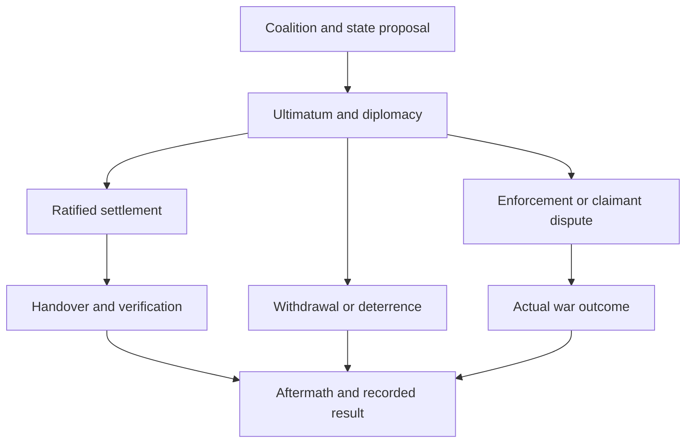

# 113 The Partition: Core experience

Several neighboring powers decide that the borders of weaker countries are negotiable.
The threatened governments receive concrete territorial demands, while the would-be beneficiaries discover that agreeing to a partition is easier than agreeing who receives its most valuable states.
The player can preserve a country through deterrence, split its claimants, accept a damaging compromise, or fight a war whose outcome the event does not predetermine.

The Partition remains a Minor Repeatable event with Chaos level 1, in the Diplomacy cluster at High member severity.
Its design identifier is 113 and its original catalog identifier is 123.
The requested planning status is To Be Reworked.
The established title and evolution names come from the user.
All other route, action, mission, achievement, and interface names in this package are working labels for design communication, with final localisation developed later from the stated directions.

## The experience in one firing

A firing creates one wave of separate partition crises.
Each threatened country has its own claimant coalition, proposed state allocation, deadline, diplomacy, and outcome.
A country that successfully resists has prevented its own partition even when another target in the same wave is divided.
A claimant's share in one target supplies no authority to take land from another target.

| Opening form | Required Chaos | Requested targets in that firing | Eligible size | Opening character |
| --- | ---: | --- | --- | --- |
| The Partition | 1 | 2 or 3 | Small minors | Limited border concessions, fragile claimant agreement, a viable remnant |
| Partition Fever | 200+ | 4 or 5 | Small or medium minors | More potential claimants, larger proposed shares, interior corridors, possible complete partition |
| Grand Partitions | 600+ | 6, 7, or 8 | Minors of any size that pass the geographic and diplomatic tests | Claims to most or all of a country, extensive protection commitments, larger wars |

The number is drawn once from the appropriate range before candidate selection.
If fewer complete eligible target-and-coalition packages exist, the firing uses the available number and records the shortfall.
One valid package permits a one-country firing.
Zero valid packages leaves the event unavailable and produces no empty firing or repeat penalty.
Poland is an example of a possible larger minor in a suitable campaign, never a scripted selection or guaranteed victim.

Majors are immune as partition targets at every stage.
That immunity also applies to an attempt to divide a major claimant as punishment after a dispute.
Majors may seek shares, provide protection, mediate, and participate in ordinary wars.
Current campaign classification governs the rule.
Neither a historical tag list nor a country's apparent weakness replaces the current major check.

## Participant roles and observation

**The threatened government** decides what it can afford to lose, which outside promises are credible, and when preparation is worth its domestic cost.
It can offer a smaller concession, expose an incompatible claim, accept a precise settlement, request protection, or reject the ultimatum and prepare for defense.
Its silence never accepts territorial loss.

**A claimant** weighs a plausible gain against coalition competition, military exposure, and the risk that a successful defense leaves it weaker than before.
It can accept a share, exchange states within a revised proposal, lower its demand, withdraw, press a larger demand, or authorize enforcement.
A claimant receives territory only through a completed agreed award or the actual result of a war.

**A protector** chooses between a diplomatic guarantee, material aid, mediation, and entry into a defensive war when legal.
Those commitments remain distinct on screen.
A promise of aid does not count as delivered equipment, and favorable opinion does not count as an active guarantee.

**An observer** can follow the diplomatic map and the outcome without receiving every participant's response popup.
Observation is an informational position until the country accepts a legal participant role.
An eligible observer may enter through the mediation or protection routes.
Ordinary diplomatic and military choices remain available throughout the crisis.

## What the player follows

The central question is which states are threatened and what can still change that proposal.
The interface therefore leads with the target, the latest map, the proposed recipients, the response deadline, and the player's role.
Population, factories, resources, supply assets, ports, and remaining states are factual summaries of the proposed transfer.
They are not new currencies.

The one custom public measure is **Coalition Cohesion**, a 0–100 assessment of whether the claimants can act together.
It reflects agreement on shares, honored commitments, and visible disputes.
It influences further demands, compromise, and willingness to enforce.
It never transfers territory, removes a country, or declares war by reaching a threshold.
The target's ability to resist comes from its actual forces, geography, alliances, resources, and choices.

The country view contains at most six primary actions for its selected role and phase.
State selection and recipient selection happen inside the proposal view rather than producing a decision for every possible state-country pair.
Ordinarily one crisis deadline and one optional support or reconstruction mission are active for the selected country.
The complete decision map and the presentation plan define the exceptions and the shared action groups.

## Crisis flow

The ordinary flow consists of coalition preparation, an ultimatum, bargaining or protection, possible enforcement, resolution, and aftermath.
These are baseline phases.
Partition Fever and Grand Partitions are the two evolution tracks that alter the available scale and behavior.

### Preparation

The firing first assembles complete feasible packages.
It chooses target countries and neighboring claimants together, with a proposed share for every active claimant and enough territory left for the promised remnant.
Countries reserved as targets cannot also be claimants against another target in the same wave.
The opening report is issued only after those packages exist.

Preparation does not award claims, create cores, move armies, debit player resources, or transfer land.
The opening proposal establishes a threat that the participants must decide how to pursue.

### Ultimatum

The ordinary response window is 60 days.
The evolved openings use a 45-day window because more demands are being advanced at once.
These are deliberate emergency windows, shorter than ordinary long-term project missions.
The interface gives the full date and the effect of expiry from the beginning.
No evolution shortens a deadline already promised to a target.

Every response popup uses a safe first option that leaves the current position unchanged and returns the decision to the persistent crisis view.
The documented native popup timeout is 13 days, so the popup is a notification and convenient entry point rather than the sole place to answer a 45- or 60-day ultimatum.
The actual crisis deadline remains authoritative.

### Bargaining and protection

The target can prepare one counterproposal at a time, and a mediator can prepare a competing proposal only with the target's invitation.
The coalition compares them against its current proposal.
Only one proposal version can be submitted for binding ratification at a time.
A material revision invalidates earlier signatures and displays exactly what changed.
At most one 15-day extension is available for genuine progress before enforcement.
Cosmetic resubmission, changing a label, and repeating a rejected unchanged offer do not buy extra time.

Protection changes the military and diplomatic calculation through actual commitments.
A guarantee can deter escalation, material aid can strengthen defense, and a mediator can make a less destructive settlement attractive.
None makes the target automatically safe.

### Enforcement

Expiry closes the expired proposal and its ratification window.
It opens enforcement or withdrawal choices for the claimants.
An AI claimant evaluates them using the current world state.
A human claimant authorizes its own participation explicitly.
The target's refusal or silence is never an instruction for the target to declare war.

When the coalition cannot assemble two willing legal attackers, its coordinated enforcement fails.
A remaining claimant may pursue an ordinary bilateral conflict under normal diplomatic rules, which is recorded as a breakdown of the coalition rather than a completed joint partition.
Existing faction obligations can widen a war beyond the signatories.
That larger conflict is handled through actual war and peace outcomes.

### Settlement and aftermath

A peaceful settlement requires the threatened country's explicit consent to the current exact state allocation and the consent of every beneficiary.
Additional treaty promises require their providers' consent as well.
The complete handover is scheduled and visible.
An interruption records the awards that actually occurred and the awards still pending.
The event never reports a complete settlement from signatures alone.

A war can end in successful defense, limited territorial loss, a complete partition, a claimant victory over its rivals, or an outcome that no longer resembles the original proposal.
The result follows actual ownership and peace conditions.
The event does not award the original plan as a bonus after a peace conference has already decided the map.

Aftermath gives surviving targets, beneficiaries, and faithful protectors a short period in which to stabilize the new situation.
Reconstruction, renewed diplomacy, and discontent have material consequences and finite lifetimes.
The old claim ledger remains historical evidence, while new decisions use the current campaign map.

## Repeatability and campaign continuity

Only one wave may be in its coordinated negotiation or territorial handover phases at a time.
Once those phases are closed, continuing wars can remain under their own outcome observation while a later firing becomes eligible through the shared repeatable-event system.
Targets still involved in an unresolved partition crisis cannot be selected again.
This prevents one prolonged war from stopping every future Partition firing.

Each concluded target receives 540 days of protection from reselection by this event.
Claimants that withdrew or reached a settlement have a matching 540-day event-owned renunciation against that target.
Ordinary diplomacy remains responsible for any separate future aggression.
The event records such aggression as a broken settlement when its own follow-through conditions still apply.

The shared event system owns the random timer, the repeatable weight reduction and recovery, the enabled setting, and the cluster's pacing behavior.
One multi-country wave counts as one firing for that system.
Its individual crises and evolution notifications do not each advance the global event timer or repeat penalty.

The event can remain disabled after implementation until its accepted completion gates are met.
The requested To Be Reworked status describes this planning package and is not a claim that the runtime event already exists.

## Reading order

Part 2 defines target selection and territorial proposals.
Parts 3 and 4 define claimant, target, protector, and mediator choices.
Part 5 defines war, handover, defense, and aftermath results.
Part 6 defines evolutions and campaign variants.
Part 7 defines dynamic balance, AI behavior, and Chaos consequences.
Part 8 defines the interface, event presentation, and assets.
Part 9 defines Tasks and other shared-system connections.
Part 10 defines difficult achievements and worked campaign cases.
The acceptance matrix, evidence report, and separate prompts complete the handoff.

