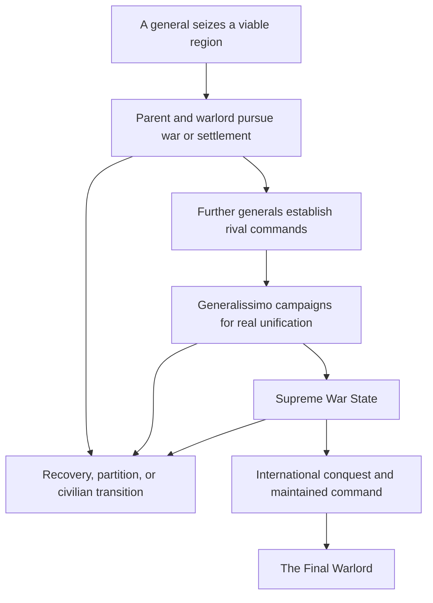

# Part 1: Warlords

Warlords begins when a general turns a part of a large country's army into the foundation of a personal state. A frontier command, industrial district, or connected interior region breaks away with forces that were already there. The new ruler controls a country, makes war, recruits soldiers, obtains weapons, and lives with the consequences of governing the territory he has seized.

The immediate crisis is local. Its political possibilities are much wider. The parent can recover its provinces, bargain with the new regime, or survive a lasting partition. Other generals can follow. A successful warlord can institutionalize his rule, become dependent on a patron, return power to civilians, or build a larger military state. Generalissimo 067 provides one special unification route. The Final Warlord is the separate, much later culmination of an international system of military command.

## The event's place in the campaign

| Field | Controlling design |
| --- | --- |
| User-confirmed package identity | 116, Warlords (user decision: adopt uploaded IDs and migrate catalog) |
| Prior catalog reference | 127 (historical provenance; catalog migration installed) |
| Proposed ordinary firing | Minor Fire-Once |
| Historical catalog snapshot | Rows 116 and 127 held their pre-migration identities in the source review; see the current README and registry for the adopted identity |
| Proposed entry Chaos level | 1 |
| Proposed cluster | Liberations |
| Proposed cluster role | High member |
| User-named evolutions | The Generals Follow, Stronger Warlords |
| Political culmination | Supreme War State, through the Generalissimo route |
| Independent world-end branch | The Final Warlord |

The package identity is accepted by the user, and the parent has installed the authorized catalog migration. The current mapping is Event 116 Warlords, with Event 111 This is SPARTA!!! and Event 110 IMRO; former rows 127 and 116 are historical. This acceptance does not approve the proposed mechanics or create runtime registration. All labels introduced by this package are structural working labels. Only the names supplied by the user are fixed names. None of the prose in this pack is pasteable player-facing localisation.

The ordinary event fires once for the world. Its first successful breakaway establishes one origin crisis and one parent lineage. Continued fragmentation belongs to that crisis and its evolutions. A failed selection or a fully restored precommit transaction does not consume the fire-once event. Discovering an existing 019 breakaway does not count as creating a second country or mint another first-breakaway reward.

## What the player must experience

The parent loses a comprehensible piece of territory and a comprehensible part of its military. The opening report identifies the actual general, the region, the initial government, the transferred formations, and the new war relationship. The player can inspect the same actors and places on the ordinary map. The loss must be painful without making the parent mechanically incapable of surviving.

The warlord begins with useful forces and serious limitations. His opening army can defend a viable position, but his ability to replace casualties depends on population, equipment, industry, imports, and supply. A powerful general gives the movement a stronger beginning. He does not grant a permanent exemption from the economy or the war system.

The first split is a completed consequence of the event. The parent response is about what to do with that consequence. Later warned defections provide a longer opportunity for prevention. A human remains in their current country by default. An explicitly chosen post-opening play-as-breakaway option may transfer the human seat after the country is proved valid. It must never be selected automatically or presented as necessary to continue the campaign.

## Campaign structure

These are campaign states, not extra evolutions. Losing control can reopen rivalries even after a political milestone has been recorded. History records what happened. Eligibility describes what is true now.

## Fixed promises

1. The founder is an actual valid general. The same live character must become the new ruler and remain available in his appropriate commander role. A copied name, portrait, or immutable profile is insufficient proof of this continuity.
2. Both the new state and the remaining parent must be viable after every split. Being a major or being player-controlled does not waive that requirement.
3. Birth and later reinforcement conserve real assets. Transfer, local recruitment, foreign support, and capture are different sources and retain their different costs and liabilities.
4. Other countries retain ordinary agency. Recognition does not compel alliance. Aid does not create obedience. A treaty binds only actual consenting or defeated participants under its real settlement rules.
5. An existing breakaway retains its country, people, current leader, forces, liabilities, and relevant history when another event encounters it.
6. Generalissimo unification requires actual campaigns and genuine control over all relevant rival commands. The Supreme War State is not a free annexation decision.
7. The Final Warlord requires later global military dominance, current effective control, strict Chaos greater than 1000, its own enabled branch, and no active world end.
8. Defeat has material aftermath. It does not restore lost lives, equipment, cities, borders, or peaceful conditions by resetting the event.

## Sources of tension

The parent trades speed against legitimacy. A rapid emergency mobilization can strengthen recovery while deepening military rule. A regional compact can preserve the state while surrendering some central authority. A negotiated partition may save lives and stabilize a front while leaving an armed rival next door.

The warlord trades personal loyalty against institutional strength. A retinue may remain loyal to its founder but struggle with replacement and succession. A professional staff and civil administration can sustain a stronger country while making the state less dependent on one man. Foreign supplies can prevent defeat and create obligations that later constrain independent policy.

The Generalissimo trades territorial breadth against enforceable command. Each subordinated regime can add real industry, soldiers, and experienced officers. It also adds routes to protect, commanders to control, and governments that can leave when obedience ceases to be real.

## Presentation and depth limits

The mechanic adds one public persistent value type, Command Cohesion. The Generalissimo owner supplies that value in its own post-takeover phase. Actor rosters, command status, current shortages, mission progress, and qualification requirements are factual readouts rather than additional currencies or competing meters.

Use existing map, diplomacy, focus, decision, and event surfaces. No new custom battalion family is needed for ordinary military regimes. No custom 3D project, elaborate headquarters screen, or recurring payment chore is added merely to make the event appear larger. The depth comes from different political futures, actual military constraints, reversible control relationships, and the consequences of the player's choices.

Numerical anchors in this package are proposed balance settings. The qualitative promises above are attributed by the package to a user brief or its authoring interpretation; this import does not independently establish their acceptance. Part 17 separates planning acceptance from the engine and integration evidence still required before implementation can be called complete.
