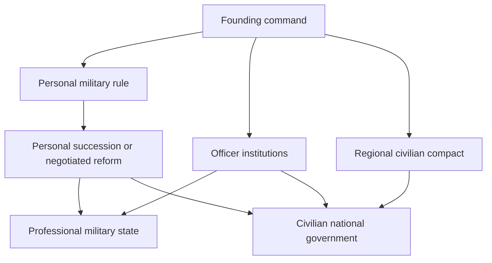

# Part 11: Focus routes and national ideas

Focus content turns a temporary military seizure into several durable political futures. It should create strategy, useful capabilities, and clear commitments. It should not repeat generic equipment grants or fill a large tree with slight variations of the same national spirit.

This is a branch-level architecture. The final node count, coordinates, and exact links belong to implementation. The required routes, turning points, consequences, and compatible branches below are design obligations.

## The warlord tree

The tree has six connected families: command constitution, army organization, military economy, regional government, foreign strategy, and succession. The political constitution supplies the strongest route locks. The industrial and military families support more than one constitution, with rewards and costs adjusted to its commitments.

The diagram covers the political relationship only. Army, industry, logistics, and external strategy remain active branches with real prerequisites throughout these choices.

## Route architecture

| Family | Opening work | Middle commitment | Late payoff | Locks and failure |
| --- | --- | --- | --- | --- |
| Command constitution | Establish actual authority over the founding command and choose how orders are legitimized | Personal retinue, officer institution, or regional compact | Durable military constitution, negotiated reform, or civilian government | Exclusive political benefits transform on a route change, and a dead founder cannot finish a personal-ruler payoff |
| Army organization | Inventory surviving formations and create an affordable line and reserve plan | Standardized professional army or a smaller founder-centered force | Theater-capable formations, useful staff coordination, or a veteran defensive army | Equipment, manpower, training, and supply constrain implementation of every template plan |
| Military economy | Repair a real arsenal or establish an actual import program | Domestic production and transport or contracted foreign supply | Sustainable replacement industry and strategic logistics | A lost site or severed route blocks the dependent payoff, without refunding completed construction |
| Regional government | Restore functioning administration and identify civilian obligations | Coercive military administration or negotiated civil institutions | Governed integration, reconstruction, and a broader political settlement | Broken concessions create actual political pressure, not a generic permanent malus |
| Foreign strategy | Define the immediate parent relationship and potential partners | Independence, patron-backed survival, local coalition, or conquest | Stable partition, independent regional power, or a larger military state | Independent allies do not count as subjects, and treaties cannot dispose of outsiders |
| Succession | Clarify command and government continuity before the founder is lost | Designate an eligible successor, empower a staff institution, or prepare civilian authority | A country that survives its founder under the chosen constitution | Capture, death, disobedience, and a failed handover use the actual surviving actors |

## Command constitution in depth

The personal route first concentrates a limited existing loyal cohort. It can improve its coordination and readiness through training and supply. The middle route gives that cohort a role as command reserve and guard for the regime. The late route must choose between an explicit succession compact and negotiating away some personal power. Its advantage is a reliable core. Its liabilities are narrow leadership recruitment and dependence on the founder.

The officer-institution route begins by opening staff functions beyond personal followers. Its middle anchors establish training, promotion, and joint command across actual formations. Its late payoff supports a larger sustainable army and orderly military succession. It requires industrial and staff resources and makes the officer institution a political stakeholder. It should not retain every exclusive retinue benefit after broad professionalization.

The civilian compact route first establishes a real agreement over administration and mobilization. Its middle anchors reconstruct institutions and place armed forces under the agreed command settlement. Its late payoff can establish a civilian national government with ordinary military capabilities. A premature handover during an unresolved armed seizure can fail. A completed handover transforms personal-rule mechanics rather than deleting the army or issuing a new civilian population.

## Army and military-economic anchors

The first army anchors reveal and organize what the country actually has. They can approve affordable templates, define a reserve, and enable training or equipment-standardization missions. A focus completion alone is not a division spawn. Distinct templates should reflect a poor infantry economy, a mobile command with actual vehicles, or an industrial state capable of sustained combined operations.

The middle army anchors connect professional staff, engineers, logistics, and doctrine development to real service needs. They can improve the use of already available capabilities or unlock a training program. Air and naval branches appear only when relevant facilities, assets, or a credible construction plan exist. Landlocked and very poor states retain a complete land-war route without blank filler nodes.

The late army payoff is operational capacity: supplied reserves, effective joint command, reliable replacements, and a coherent theater plan. It does not automatically win an offensive. A focus objective that requires a captured hub completes from actual campaign proof and provides a relevant follow-through, such as an approved repair program or integration mission.

Economic anchors name their productive sites. Early choices weigh repairing damaged military capacity against preserving civilian construction. Middle choices build a domestic replacement base or a contracted import system. Late choices connect multiple districts through actual transport and sustain expanded forces. A successful import route remains exposed to foreign terms and interdiction. A domestic arsenal remains exposed to bombing, occupation, and resource shortage.

## External strategy anchors

The survival route explores a ceasefire or partition with the parent and limited guarantees from neighbors. It favors preserving the state and rebuilding. Its late success is a stable independent government, not an automatic expansion bonus.

The patron route obtains actual supplies and potentially intervention at a declared political price. Its middle choice is to deepen the relationship or build an independent alternative. Its late outcomes are genuine subordination, renegotiated partnership, or an independence campaign. A patron contract may expose appropriate decisions before a focus is completed, so a poor new country is not forced to wait months for the first means of obtaining ammunition.

The expansion route prepares real claims or war goals where supported, logistics, and integration. It never transfers territory at focus completion. Its late payoff is a larger ordinary state under the chosen constitution. The Generalissimo route becomes available only through the actual 067 actor and owner, not as a generic final focus for every founder.

## Parent content

Preserve the parent's existing national tree. Add a compact compatible branch or an equivalent decision route that covers the four responses in Part 5. Early anchors secure command and supply. Middle anchors commit to recovery, a regional compact, partition, or emergency military government. Late anchors settle surviving armies and rebuild institutions.

The parent route must remain playable if national content, another event, or a mod makes an additive branch technically unsafe. The decision equivalent must carry the same essential choices, costs, proofs, locks, and payoffs. A compatibility route is not permission to replace four strategies with a single generic recovery button.

## Generalissimo and Supreme War State content

Preserve 067's canonical takeover, removal, country, and focus ownership. The 116 addition supplies warlord campaign objectives, actual submission agreements, military integration, and the domestic consolidation milestone. It must not create an alternate introduction that bypasses 067's actor lifecycle.

After formation, the new route has three families. Internal command integrates surviving officers, armies, and institutions. Theater development establishes useful command and supply anchors. International campaigns prepare actual operations against qualifying powers and consolidate their surrender. These can progress in parallel where resources allow.

The late route exposes Final Warlord readiness and preparation. Completing its final focus cannot launch the ending. It can make the strategic assessment available, remove an earned organizational barrier, or complete an internal reform. The shared terminal gate in Part 9 remains authoritative.

Resistance and fragmentation must remain playable after the order is formed. A subordinate's compatible content includes defending negotiated rights, preparing a real independence effort, obtaining outside support, and reorganizing after liberation. This may be an additive decision route rather than a second giant focus tree.

## Pacing and rewards

Fundamental route changes surrender specific privileges. The following transition matrix is part of the idea and recruitment lifecycle, not an additional set of focus branches.

| Transition | Benefits or authority retired | What remains real |
| --- | --- | --- |
| Personal retinue to professional staff | Exclusive private-command advantages and permissions incompatible with institutional control | Current officers, formations, equipment, and legitimately earned experience |
| Military government to civilian authority | Independent political-army privileges, personal-rule effects, and emergency powers actually surrendered | The ordinary national army under the performed civilian command settlement |
| Central rule to regional compact | Central recruitment, revenue, or command rights expressly granted away | Agreed common institutions and only the resources still available under the compact |
| Independence to genuine patron subordination | Independent military policy and exclusive rights ceded in the real contract | Local government and actual assets under the new lawful chain of command |
| Emergency parent rule to restored civilian government | The military powers and temporary benefits explicitly rolled back | Completed reconstruction, lawful appointments, and surviving institutions |

The same retinue cannot remain an independent political army while also being counted as a disarmed manpower return or fully integrated central reserve. Political and military succession can belong to different real actors and need separate proof.

Opening anchors generally take around 35 days, middle commitments around 56 days, and major late reforms around 70 days. Adjust these starting values to the amount of parallel activity, country size, prerequisites, war pressure, and real reward. A focus that depends on a long campaign may complete promptly after the campaign proof, rather than adding an unrelated long wait. Mission deadlines remain separate and should not be shortened below the ordinary 90-day floor without a justified special situation.

Use varied rewards: access to useful decisions, lawful command reform, improvements to native training or planning, specific repair or construction programs, bounded research support, treaty opportunities, and transformations of an existing idea. Preserve physical cost where a reward creates a material object. Rewards for surviving a crisis can reduce the pressure that was actually resolved without erasing prior destruction.

## Idea lifecycle: warlord country

| Slot | Initial condition | Upgrade or transformation | Failure and removal |
| --- | --- | --- | --- |
| Command constitution | Improvised personal military authority | Personal retinue constitution, officer institution, or civilian compact, then owner-approved 067 integration or civilian government | Founder loss and route breach transform the actual constitution, civilian settlement retires personal-rule effects |
| Military-economic organization | Fragmented inherited arsenal and equipment mix | Standardized domestic system or supported import organization, with real capacity conditions | Losing the required arsenal or route suspends the relevant benefit and opens repair or policy change |
| Temporary integration or reconstruction | Disruption in actual newly governed territory or institutions | Progressively reduced through completed material and political objectives | Expires when the obligation is settled, changes when control is lost, never stacks per annexed tag |

## Idea lifecycle: parent and Generalissimo host

| Country role | Intended slots and progression | Required cleanup |
| --- | --- | --- |
| Civilian parent | Temporary divided command, one chosen settlement or emergency constitution, and bounded reconstruction | Resolve divided-command pressure after actual command stabilization, retire emergency effects on lawful rollback, retain only fulfilled lasting reforms |
| Existing 067 host | Reuse 067's owned command and country-package ideas, transform a compatible slot for unified warlord command | No duplicate Command Cohesion spirit or parallel takeover package, owner handles canonical removal |
| Supreme War State | Unified command constitution, actual military-economic coordination, and temporary theater integration | Benefits depend on current usable command, lost relationships remove their contribution, historical formation remains recorded separately |
| Liberated successor | Current lawful constitution, sustainable military organization, and genuine reconstruction if needed | No inherited terminal omnipotence, no renewed starting grants, no erasure of surviving institutions |

This package occupies at most three simultaneous focus-created spirit slots in an affected country. When 067 or 019 already owns the relevant active slots, transform or reuse them through that owner rather than adding competing copies. Do not remove unrelated meaningful national content to satisfy an artificial display target. The implementation must document the combined event-package spirit budget and actual modifier totals.

## Route coverage and acceptance

Every required route has an entry, at least one meaningful middle commitment, a distinct payoff, AI preference, a failure or invalidation path, and a compatible postwar future. Report any route that is missing, merged, renamed, replaced, or implemented through the equivalent decision path. Renaming two identical branches does not count as preserving both strategies.

Review representative poor, industrial, landlocked, coastal, already-019, parent, 067, civilian-successor, and terminal-defeated countries. A route must not strand one of them behind an impossible DLC condition, nonexistent character, lost focus tree, or unavailable equipment definition. Source inspection is the first gate. Actual focus rendering, reachability, AI, persistence, and in-game behavior require the mapped future evidence.
