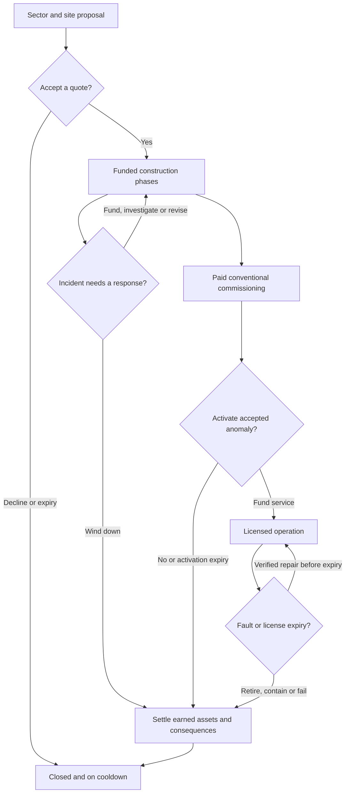

# Investment specification, part 1: Core experience

## 1. Design commitment

Investment gives one government an opportunity to build a substantial piece of its future economy. The government selects a sector, a legal site and a delivery policy, then diverts civilian industrial capacity into a funded construction charter. The investment produces real buildings and useful industrial capability after work has been performed. Difficult projects ask the government whether to pay for completion, examine a contractor's claims, reduce the unfinished scope or accept a loss.

The baseline should feel worth accepting. A modest country can establish its first useful industrial complex without having to qualify as a major power. A large country can add a district or address a particular production bottleneck. The opportunity includes outside capital and organizational support, which is why its public construction burden is deliberately cheaper than building the complete package through ordinary construction. That subsidy is finite, attached to the accepted charter and paid out through verified delivery.

The central strategic question is how much productive capacity to tie up, for how long, and under how much unresolved risk. War can make a future arsenal attractive while making its construction burden painful. A shipbuilding program can secure long-term naval production while consuming the same civilian industry needed for repairs. A special-industry campus can be valuable even when its research applications are still distant.

At higher Chaos, the government can accept a multi-state program or an industrial process whose promises exceed ordinary engineering. These choices expand the stakes. They preserve the original paid construction loop and the ability to finish an existing conventional agreement.

All route names, table labels, outcome labels and mechanic names in this package are structural working labels. They specify the design and do not supply final localisation. The numerical values are proposed starting balance, subject to the explicit tests in part 6. Changes after implementation review must preserve the choices and invariants described here.

## 2. Identity and intended registration

| Field | Specification |
|---|---|
| Requested event identity | Investment, ID 121 |
| Original catalog identity | Investment, ID 132 |
| Proposed event type | Minor Repeatable |
| Proposed baseline Chaos level | 1 |
| Proposed cluster | Positive Economy, ID 7 |
| Proposed baseline member severity | Low |
| Historical brief status | To Be Reworked |
| Current catalog status | Unavailable |
| Package status | Complete proposed design, prepared for implementation |
| Evolution I | Megaproject Fever, eligible at Chaos 200+ |
| Evolution II | Impossible Industry, eligible at Chaos 600+ |

The pre-migration repository workbook assigned ID 121 to The Pact and ID 132 to Investment, both Unavailable. On 2026-10-24 the user accepted Investment ID 121 and authorized catalog migration. The current registry records Investment at 121 and preserves The Pact as a displaced concept. Catalog status remains Unavailable, no runtime event root is implemented, and mechanics/classification remain proposed. The workbook and current Positive Economy membership were checked at the pinned revision recorded in the source register. [Repository catalog and source authority](121_investment_sources_and_review.md#source-register).

## 3. Country selection and access

Each independent firing selects exactly one eligible country. Players, AI majors and AI minors use the same structural eligibility. There is no major-only preference and no automatic human priority. Selection is uniform across the complete eligible country pool at the moment of selection.

A country is eligible when it exists, can own a normal industrial project, controls and owns at least one legal supplied site, has at least one genuinely usable civilian factory after other obligations, has no active Investment charter and is outside its Investment cooldown. Existing industry or state classifiers should determine compatibility for exceptional actors. A special Chaos identity alone must not be confused with an economy incapable of using ordinary civilian construction.

Usable capacity means capacity available for a new commitment after consumer-goods requirements and other owner systems' reservations have been accounted for. A factory already committed to Industrial Boom, Great Depression, a native operation or another mechanic cannot fund this charter a second time. A country with zero genuinely usable capacity stays outside this firing's candidate pool. It does not receive a free factory to make the offer affordable.

The selected country is fixed before the shared random-event history recorder runs. The announcement, proposal decisions, event details, cluster pacing and history row all refer to that same actor. If the candidate becomes invalid before the offer is published, selection may retry once from the remaining valid pool. An offer that is already published is never silently reassigned to another country.

The government receives a 90-day proposal window. It can inspect the four sectors, consider the available sites and decline at no cost. Decline or proposal expiry gives a 180-day country cooldown. Once any phase has been funded, every terminal result gives a 540-day cooldown. Abandoning a troublesome project cannot create a faster route to another subsidized opportunity.

The shared Minor Repeatable picker and Positive Economy cluster remain responsible for general event pacing. Construction phases, incidents, evolution offers, commissioning and failure consequences do not consume additional independent firings. The new event must use the current shared pacing configuration rather than copying historical values from an older planning document. [Current mechanics and event integration](121_investment_sources_and_review.md#source-register).

## 4. What the player manages

One country has one active charter. A baseline charter has one main site and may include one supporting site. A Megaproject Fever charter has two to four sites. A charter has one selected sector, one agreed scope and one controlling beneficiary, even when several sites contribute to the result.

The decision category exposes two persistent mechanic values.

| Value | Meaning | How the player uses it |
|---|---|---|
| Work Complete, 0–100 | Verified paid work against the currently agreed construction scope | Shows how much of the agreement has actually been performed and which phase can finish |
| Exposure, 0–100 | Unresolved procurement, supervision and technical risk | Helps judge whether to inspect, accept a more expensive completion, reduce scope or stop |

Exposure is an index. A displayed value of 40 does not mean a 40% failure probability. Its tooltip identifies the actual sources of risk and the checkpoint band in which the project currently sits. The issue probabilities are defined in part 3 and tested in part 6.

The category also shows the selected sector, the current phase, an ordinary timer, the held civilian capacity and compact site statuses. These are status and quote facts. Do not add a separate public budget currency, a confidence meter, an anomaly meter or individual site progress gauges. The portfolio summary should let a player understand the commitment without reading implementation fields.

An amendment changes the denominator of Work Complete only after the government accepts the new scope. The amendment preview shows both the already completed work and the additional unpaid work. It preserves all original receipts, consumed checkpoints and completed assets. Reducing scope can change the displayed fraction, but cannot manufacture a completed phase, reset an audit allowance or produce an achievement from cancelled work.

### Main player loop

This diagram shows the principal choices. Parts 3 and 4 define the exact payment, warning, activation, repair and closure rules. Settlement can retain physical assets while an honest finite economic consequence continues.

## 5. Funding has a real industrial cost

The charter reserves civilian factories through an Investment-owned commitment modifier. Those factories are unavailable for ordinary construction while held. Their funded time pays for contracts, materials, transport and labor. This is the event's economic funding model. It does not introduce a treasury balance or reinterpret international-market capacity as money.

The inspected Event 34 source demonstrates a native `civilian_factory_use` reservation pattern. Its helpers also change Industrial Boom's own lifecycle, so Investment must own its quote, hold and release. That precedent does not establish safe affordability. Investment requires the inclusive affordability and competing-reservation checks in part 4. The universal cost framework also distinguishes a quote from payment and does not automatically cover factory commitments. [Reservation and exact-cost evidence](121_investment_sources_and_review.md#source-register).

### Ordinary scale envelopes

| Envelope | Normal held civilians | Principal units, U | Nominal funded days | Nominal public work |
|---|---:|---:|---:|---:|
| Small | 1 | 1 | 300 | 300 civilian-factory-days |
| Standard | 3 | 2 | 360 | 1,080 civilian-factory-days |
| Large | 5 | 3 | 420 | 2,100 civilian-factory-days |

These are Investment balance anchors, not claims about native building costs. Special industry multiplies the nominal duration and work by 1.5 because its principal output is a facility or a deliberately specified industrial bundle. Supporting infrastructure, variant substitutions and evolution packages are included in the accepted quote.

The default proposal chooses a scale appropriate to the country. The AI ordinarily reserves no more than 25% of its usable civilian capacity. A one-factory small economy may still accept the Small envelope in a reasonably secure peace, accepting the clear temporary sacrifice of its only construction factory. Players can choose any offered scale they can actually afford. A larger industry's existing military factories cannot substitute for missing civilian construction capacity.

The Special multiplier and Part 2's exact site factors modify the initial work requirement. Low infrastructure, non-core placement and the payer being at war each add 10% through that bounded factor. Real supply and legal control remain eligibility conditions. The expected funded duration normally remains within 180–720 days for ordinary non-special projects, or 270–1,080 for ordinary Special projects. Round phase durations upward to five-day increments. Recompute an unaccepted offer when its inputs change. Freeze scope, required work and promised outputs when it is accepted.

A later incident or policy change proposes an amendment to remaining work. It never reprices work that has already been paid. A phase can be funded with a smaller available hold where the revised completion time remains viable, but it still owes the original work quantity. Completing a project after the government has spent its remaining political power or changed its ordinary construction queue must not require paying its original price again.

## 6. Delivery policy

| Policy | Initial Exposure | Public burden and time | Strategic reason to choose it |
|---|---:|---|---|
| Verified tender | 10 | 20% more required work at the normal hold | A slower, better documented route for a government that values predictable delivery |
| Matched capital | 25 | Normal agreed work | A balanced way to receive the outside investment and complete the sector package |
| Accelerated delivery | 40 | Hold `ceil(1.5 × normal hold)`, no more than twice that hold, and add at least 10% to remaining required work | Faster completion when present wartime or industrial need justifies greater capacity use and weaker supervision |

The accelerated option must be affordable at its integer hold. A Small charter therefore requires two civilians to accelerate. A one-factory country cannot select an acceleration whose preview rounds down to one factory. The actual shorter duration follows from the higher hold divided into the larger work requirement. Do not apply a second arbitrary time discount after that calculation.

Megaproject Fever adds 15 Exposure to the chosen policy. An impossible method adds another 20 before its inspection or operating-mode adjustments. Part 3 defines the exact once-only contextual and incident additions. Policy changes are bounded amendments to unfinished work, with their new cost and risk shown before payment. Increasing policy risk adds only the amount above the highest policy risk previously accepted. Selecting a safer future policy does not automatically subtract earlier Exposure.

## 7. Three paid phases

Every site's work passes through mobilization, works and commissioning. Their normal shares are 25%, 50% and 25% of its accepted work budget. Each phase requires its own authorization and positive commitment receipt. The phases are normal lifecycle stages, not evolutions.

**Mobilization** secures the plan, surveys the site and prepares supply and contractors. It produces verified reusable work, but no principal factory. This gives a government an early chance to withdraw before committing most of the agreement.

**Works** performs the bulk of construction. At its end, the agreed enabling improvement can become usable. In a baseline package with at least two principal units, at most one principal unit can also be delivered if its full assigned cost share has been covered. A one-unit package still needs commissioning for its principal outcome. A native research facility always waits for commissioning.

**Commissioning** verifies and opens the remaining capacity. Paid work plus current delivery legality produces an observed physical grant, followed by a durable success receipt. The project then releases its own hold and applies its earned commissioning dividend. The player does not need an additional claim-reward click.

At a phase boundary, funding the next phase is a real choice. The government has 90 days to do so and may use one 30-day orderly extension for a genuine shortage. These windows sit inside the site's cumulative 180-day dormant allowance. Pausing, losing control, recovering the site and funding a later phase do not reset that allowance.

Multi-state programs can commission sites sequentially. A factory already commissioned remains a real factory if a later site fails. A completed port or infrastructure level is not removed merely because the government abandons a different unfinished part of the program. The project history distinguishes full completion, agreed reduced completion and partial wind-down.

## 8. Trouble should create decisions

Ordinary projects have two single-use issue checkpoints at 30% and 70% of agreed work. The checkpoint records belong to the charter and survive amendments. A delayed callback resolves the due checkpoint once. Saving, pausing or switching sites does not create a new roll. Only one incident is active at a time.

The normal issue families are delivery delay, a genuine cost overrun and suspected corruption. Each explains what has gone wrong, what is known and what remains uncertain. A delay might reflect a supplier bottleneck. An overrun might follow a change in the required works. A corruption case needs evidence of an invoice, missing materials or collusion, with its underlying truth frozen for that case.

The response set is consistent enough to learn while retaining distinct consequences.

| Response | Benefit | Sacrifice |
|---|---|---|
| Fund revised completion | Keeps the promised scope and usually resumes quickly | Pays the actual additional work and may leave weak supervision unresolved |
| Investigate and replace | Can remove a fraudulent future surcharge and reduce Exposure | Uses political authority and funded time while construction pauses |
| Reduce unfinished scope | Makes a smaller useful result affordable | Gives up named undelivered outputs or the commissioning dividend |
| Wind down | Releases the remaining construction burden and preserves earned physical assets | Writes off consumed work and closes the current opportunity |

Inspection uses the exact ordinary-cost quote from a 25 political-power base and 20 funded days without construction credit, or 40 days for a megaproject. One inspection per original phase removes up to 15 existing procurement-risk points under Part 3's source-residual rule. It cannot bank a future reduction or remove an anomalous method's separate risk or full-risk floor. A live incident's investigation uses the same audit allowance or replaces that phase's inspection, preventing repeated risk reduction through menu cycling. A case already inspected cannot sell the same evidence again.

Routine randomness creates a problem that can be answered. It does not instantly erase an ordinary country or force a national depression before the player can act. Severe national failure belongs to a materially overextended megaproject or a dangerous impossible operation. Those consequences have explicit thresholds, warning and settlement rules in part 3.

## 9. Outcomes and lasting value

Full completion grants the accepted physical outputs and the appropriate temporary commissioning dividend. The full dividend lasts 180 days and is consolidated into one event-owned family. Fever uses one program-level receipt, with a 90-day dividend for an explicitly agreed reduced terminal completion and no separate early-site dividend. Depending on the route, it improves construction, production efficiency, dockyard performance, repair or industrial research. Its actual effects are defined in part 2. Important effects use meaningful values, normally 5–15%, instead of a collection of negligible bonuses.

A reduced completion grants only the explicitly renegotiated outputs. It records the reduction and cannot qualify as full-scope success for an achievement. An orderly wind-down retains already commissioned buildings and any enabling works that were genuinely earned. Reusable unfinished work can create one site-bound brownfield credit, capped at 25% of corresponding work in one later eligible project. The credit is neither cash nor a transferable national resource.

Consumed civilian-factory-days are lost effort. They cannot be refunded. Removing a future hold returns productive capacity to normal use, which is different from reimbursing past spending. Any separately consumed refundable resource follows its actual receipt, exact original discount and valid payer. Part 4 specifies the terminal transaction.

Completed physical buildings follow normal state control. A commissioning dividend depends on control of its qualifying site and retains its original expiry date. Recapture can restore only its remaining valid period. It cannot restart the benefit. Captured buildings do not count as the occupier completing an Investment charter.

Control loss pauses and releases the affected unfinished site's hold. Other valid funded sites can continue. Permanent transfer closes the original payer's unearned obligations at that site. Annexation retires the payer's charter and its callbacks. None of those routes may treat an annexer as the original paying government merely because a callback's ROOT changed.

## 10. Readability and completion standards

The initial category presents four sector choices and decline. After a sector is selected, the proposal presents funding, site selection, delivery policy and return. An active construction phase presents acceleration, inspection, revision and wind-down. A funding boundary presents the next phase's purchase. A live incident replaces ordinary controls with its response set.

These are distinct states of a compact flow. They are not six permanent screens of simultaneous actions. Ordinary phases should expose three to five primary actions and never exceed the six-action readability budget. The native mission display should normally contain one phase or funding timer and one incident objective, with three as an exceptional ceiling.

The first implementation is complete when a small AI country and a player can both accept a legal charter, pay for all three phases, receive the correct sector output and close without leaked commitments. Completion also requires the authored partial results, incidents, evolution choices, ownership transitions, AI behavior, assets, localisation, achievements and catalog migration to satisfy the remaining parts. A clean baseline alone does not satisfy the full requested expansion.

Continue with [part 2, sector projects](121_investment_spec_part_2_sector_projects.md), [part 3, evolutions and consequences](121_investment_spec_part_3_evolutions_and_consequences.md) and [part 4, decision and lifecycle detail](121_investment_spec_part_4_decisions_costs_and_lifecycle.md).
