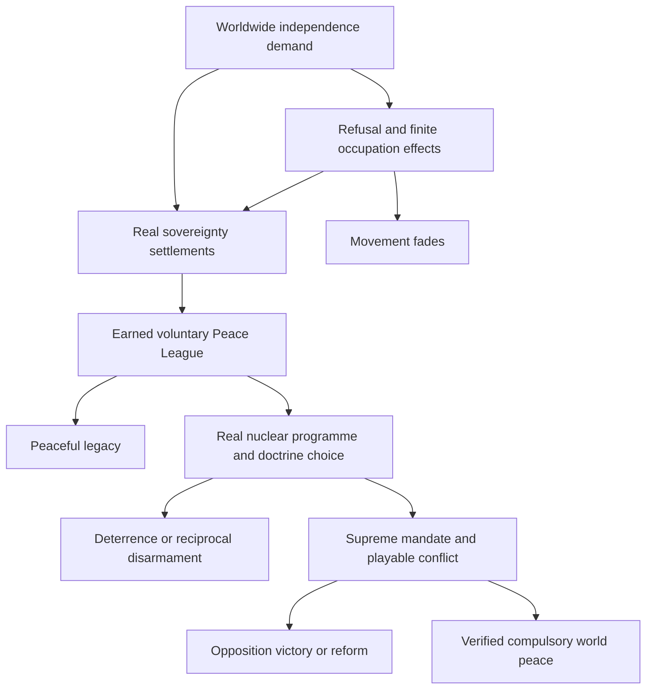

# 122 Gandhi planning package

The 2026-10-24 user decision accepts the uploaded identities Event 121 Investment and Event 122 Gandhi, and authorizes the catalog migration. For Gandhi, the user-authorized identity/catalog migration is implemented in the workbook and registry; Gandhi is at 122, Cossacks is at 112, legacy catalog hold 122 is released, and the catalog status remains Unavailable with no runtime event root. It does not accept gameplay mechanics or classification. The package proposes original catalog identity 133, Minor Fire-Once, Chaos 1, and Liberations High. The imported pre-migration snapshot recorded 121 (The Pact), 122 (Rise of Cossacks), 132 (Investment), and 133 (Gandhi) as Unavailable. Current registry evidence records Gandhi at 122, Cossacks at 112, releases the legacy 122 hold, preserves the displaced catalog rows, and leaves Gandhi Unavailable with no runtime root.

References below to an “accepted design” or a prior gameplay approval reproduce claims made by the imported package's authors; they do not establish current acceptance. The 2026-10-24 user decision accepts Gandhi's uploaded Event 122 identity and authorizes the related catalog/registry migration, but leaves all gameplay specifications and classification proposals unresolved. The original brief and source-reading receipts remain historical records.

This package expands Gandhi into a complete proposed Chaos Redux event, from worldwide noncooperation to voluntary international cooperation, national nuclear deterrence and a defeatable attempt at compulsory world peace. It includes thirteen specification parts, six implementation and production prompts, historical and repository research, a full source-reading receipt and a package validation report.

Extract the single `122_gandhi_specs` folder under `docs/specs/`. The intended location is `docs/specs/122_gandhi_specs/`. Start with Part 1 and read the numbered parts in order. The coding prompt then provides the implementation handoff.

## The design in one view

| Stage | Entry | Main play | Complete alternatives |
| --- | --- | --- | --- |
| Worldwide movement | One valid non-core holding and an eligible first firing | Real independence, exact noncooperation, finite morale pressure and the preserved fascist exception | Negotiated sovereignty, partial settlements, survival through expiry, voluntary last-state succession |
| Peace League | Chaos 400+ and earned durable successes with consenting independent members | Paid reconstruction, genuine mediation, joint protection, leadership and membership choices | Peaceful legacy, institutional succession, ordinary departure or dissolution |
| Nuclear Pacifism | Chaos 800+, a strong League and real national nuclear capacity | Research cooperation, inspections, reciprocal disarmament, threats, national vetoes and principled dissent | Stable national deterrence, verified disarmament, split or reform |
| Ultimate Society | Chaos strictly above 1000 and the full political, industrial, success and arsenal gates | Constitutional mandate, congress, world demands, coercion, defections and opposition | Gandhi's defeat, negotiated reform or a verified compulsory-peace ending |

The event uses two persistent public custom values, Movement Momentum and League Cohesion. It uses three replacing national-spirit families. Its countries retain their own national identities, meaningful focus trees and ordinary human armed forces. The interface uses native decisions, finite missions and a static category picture.

## Preserved requirements

Every valid non-core holder is included, including AI minors, subjects and annexed territories whose owner and controller are the same. Non-fascist refusal sets resistance and compliance to zero while independently denying all useful occupation factory, resource and recruitment output. Loss of Morale is temporary. Actual independence ends the local campaign, and ignoring it eventually allows the finite movement to fade.

Fascist governments retain the requested exception. Noncooperation fails locally and can improve occupation control. The design protects this asymmetry while preventing repeated benefits from ideology or ownership cycling.

The Peace League is voluntary and initially compatible with members' existing factions. A defence compact needs a separate lawful choice. Nations can leave, oppose nuclear coercion and retain their own weapons. Nuclear technology, inventory, custody, law, consent and delivery are separate real requirements.

The final route requires Chaos above 1000, substantial earned results, a powerful coalition across regions and a credible distributed arsenal. Gandhi becomes a country's ruler only through an explicit domestic mandate. His compulsory project has a playable campaign, meaningful opposition and several defeat paths. The shared terminal world-ending state is used only after a verified final resolution.

## Specification contents

| Part | File | Principal content |
| --- | --- | --- |
| 1 | [122_gandhi_spec_part_01_noncooperation.md](122_gandhi_spec_part_01_noncooperation.md) | Identity, global eligibility, finite occupation effects, fascist treatment, values, person and evolution entry |
| 2 | [122_gandhi_spec_part_02_sovereignty_settlements.md](122_gandhi_spec_part_02_sovereignty_settlements.md) | Beneficiaries, competing claims, shared transactions, wars, last-state succession and durable credit |
| 3 | [122_gandhi_spec_part_03_peace_league.md](122_gandhi_spec_part_03_peace_league.md) | Foundation, voluntary membership, governance, aid, mediation, defence and peaceful legacy |
| 4 | [122_gandhi_spec_part_04_nuclear_pacifism.md](122_gandhi_spec_part_04_nuclear_pacifism.md) | Actual capability, national arsenals, research, policy, inspection, dismantlement, threats and dissent |
| 5 | [122_gandhi_spec_part_05_ultimate_society.md](122_gandhi_spec_part_05_ultimate_society.md) | Entry gates, supreme congress, coercive campaign, opposition, victory, defeat and terminal ownership |
| 6 | [122_gandhi_spec_part_06_country_packages.md](122_gandhi_spec_part_06_country_packages.md) | Identity, leaders, capitals, laws, technology, economy, stock, forces and continuity |
| 7 | [122_gandhi_spec_part_07_focus_architecture.md](122_gandhi_spec_part_07_focus_architecture.md) | Substantial host and member paths, political choices, cross-links, reward families and route-specific AI |
| 8 | [122_gandhi_spec_part_08_decisions_missions.md](122_gandhi_spec_part_08_decisions_missions.md) | Complete action maps, real payments, mission lifecycles, target selection and cleanup |
| 9 | [122_gandhi_spec_part_09_ai_pacing.md](122_gandhi_spec_part_09_ai_pacing.md) | Contextual AI, pacing, regional variation, nine rare variants and exploit resistance |
| 10 | [122_gandhi_spec_part_10_chaos_interactions.md](122_gandhi_spec_part_10_chaos_interactions.md) | Causal Chaos matrix, repeat guards, geography and Events 006, 009 and 106 connections |
| 11 | [122_gandhi_spec_part_11_presentation_assets.md](122_gandhi_spec_part_11_presentation_assets.md) | Direction-only text, native presentation, every asset family, provenance and three super-events |
| 12 | [122_gandhi_spec_part_12_achievements.md](122_gandhi_spec_part_12_achievements.md) | Twelve difficult achievements with exact receipts, disqualifiers, observation and icon directions |
| 13 | [122_gandhi_spec_part_13_implementation_validation.md](122_gandhi_spec_part_13_implementation_validation.md) | Dependency order, ownership, lifecycle, performance and forty-eight acceptance scenarios |

## Separate handoff prompts

| Prompt | Use |
| --- | --- |
| [122_gandhi_coding_prompt.md](122_gandhi_coding_prompt.md) | Full integrated implementation |
| [122_gandhi_asset_prompt.md](122_gandhi_asset_prompt.md) | Country, event, UI, icon, flag and other visible asset production |
| [122_gandhi_super_event_prompt.md](122_gandhi_super_event_prompt.md) | Research, text direction, images, music and wiring for the three major presentations |
| [122_gandhi_achievement_prompt.md](122_gandhi_achievement_prompt.md) | Achievement predicates, storage, backend binding and asset production |
| [122_gandhi_decision_mission_prompt.md](122_gandhi_decision_mission_prompt.md) | Native decision and mission implementation |
| [122_gandhi_goal_prompt.md](122_gandhi_goal_prompt.md) | Compact implementation orientation within the required 3,500 to 4,000 character budget |

The goal prompt does not replace the full specification. Each specialist receives bounded ownership, and the coding parent remains responsible for shared integration.

## Evidence and research

- [122_gandhi_original_brief.md](122_gandhi_original_brief.md) preserves the supplied event brief verbatim.
- [122_gandhi_evidence_and_decisions.md](122_gandhi_evidence_and_decisions.md) separates requirements, research, authored expansions and implementation questions.
- [122_gandhi_source_reading_receipt.md](122_gandhi_source_reading_receipt.md) inventories all 152 distinct supplied source versions and explains the complete reading gate.
- [122_gandhi_source_reading_receipt.json](122_gandhi_source_reading_receipt.json) provides byte counts, full hashes, duplicate paths and reviewer attribution for all 194 copies.
- [122_gandhi_historical_research.md](122_gandhi_historical_research.md) records seven primary-text sources, exact coverage and the boundary between historical Gandhi and the fictional routes.
- [122_gandhi_repository_research.md](122_gandhi_repository_research.md) records targeted current-source findings, immutable references and unresolved capability questions.
- [122_gandhi_agent_mcp_usage.md](122_gandhi_agent_mcp_usage.md) maps all 23 supplied custom roles and current service families to future work, conditional use and justified non-use.
- [122_gandhi_package_validation.md](122_gandhi_package_validation.md) records the actual final document and archive checks and the bounded integration review.

## Reading and production status

All mandatory supplied source versions were fully processed across the parent and three delegated reviewers before the specification was written. Exact duplicate copies were hash-verified. Truncated displays were reread. No required supplied source was left unread. The custom project subagent definitions were processed and mapped, while the actual delegates were generic agents in this session.

Additional historical and repository research was targeted. Its full and partial reading extents are explicitly recorded. The whole external repository and every page of every research publication are not claimed as fully read.

The package completes planning. Gameplay code, assets, final localisation, final quotations and music remain future production. No HOI4 MCP check or live-game test is claimed. The numerical anchors require later implementation and balance evidence.

## Most consequential implementation gates

Exact zero occupation income must be proved under the installed engine's stacking rules. Living-beneficiary transfers and whole-country succession need audited coordinator extensions. Genuine League mediation needs an exact peace adapter. Nuclear transfers or captured-device operationalization need a conserved owner service and are optional to the core nationally owned arsenal path.

The user's acceptance of Gandhi 122 is established. The authorized Cossacks 112/catalog migration is recorded in the current registry. This identity acceptance does not approve the package's gameplay design. Final presentation IDs, achievement backend details, DLC delivery branches, portraits and licensed recordings require their own current evidence.

These limits are written into the specification as concrete acceptance conditions. They are not silently replaced by weaker mechanics.
