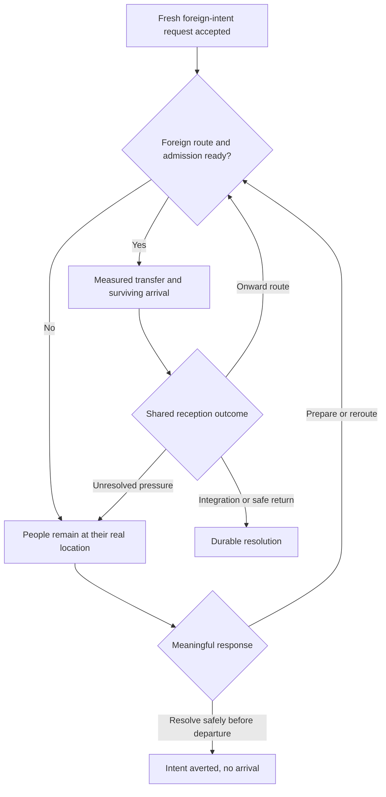

# Event 131: Immigrations

## Part 1: Core design

### 1. Design identity

| Field | Design direction | Status |
| --- | --- | --- |
| Event identity | 131, Immigrations | User-directed brief (accepted identity) |
| Former catalog identity | 149, superseded by 131 | Brief provenance and the registry adoption recorded on 25 October 2026 |
| Event type | Minor Repeatable | Proposed in the brief |
| Entry Chaos level | Level 1, available from 0+ | Proposed in the brief |
| Cluster | Domestic Unrest, Medium member | Proposed in the brief |
| Runtime role | Start a new, evidenced migration episode through the shared migration system | Required by the brief |

The event introduces a sudden decision by real people to leave an inhabited origin for a plausible foreign destination. The player responds to where people are, what route is possible, and what the affected countries can actually provide. The event's initial report should make those three facts understandable immediately.

The event is useful in both troubled and calm campaigns. War, famine, occupation, or another evidenced local crisis can create urgency. In calm conditions, the episode can concern perceived safety, employment, or better living conditions. A calm episode does not need a fabricated famine, persecution flag, or war to justify itself.

The source and numbering reconciliation is documented separately. The restored starter must retain the shared migration model. Its source identity does not give it ownership of physical population movement or a competing reception system.

All labels below describe design functions. They are working labels, not final localisation.

### 2. What a firing means

A successful firing means the migration owner has accepted a fresh, positive request tied to a specific origin, episode, cause, and foreign destination intention. That acceptance establishes a real outstanding population obligation in the shared system. It does not establish an arrival.

The event owns its premise, identity, reporting context, and any narrowly attributable event contribution to Chaos. Migration owns accepted population claims, live cohorts, route selection, destination consent, departure and reception policy checks, shelter and transport, actual transfers, losses, integration, resettlement, and return. The physical movement primitive remains the only source of origin debits and destination credits.

If the final request cannot be accepted, the attempted selection produces no new wave and no successful event-history entry. A dismissed report also has no bearing on whether the people have reached safety. Prepare the actual actors and accepted request before the shared firing record is committed so the first history entry is truthful.

### 3. Eligible origins and participants

Majors, minors, subjects, and player countries are eligible for every role permitted by their actual circumstances. Country size or player control does not make a country the default victim or the default recipient.

An origin must contain actual living civilian population and have valid existing human owner and controller countries under the shared humanitarian predicates. Apply the current predicate and its documented exceptions. Do not substitute a broad assumption that every resolvable country scope or every human-looking special country is eligible. Subjects retain their real policy and diplomatic constraints.

Select one inhabited origin state for the initial episode. Further movement into other states or countries follows the shared system. This keeps the starter legible and provides a precise population source without manufacturing a national population drain.

At least one plausible foreign destination must exist at selection time. Plausibility requires a real foreign country, a real possible endpoint, a geographic or supported transport relationship, and a credible reason for people to consider that destination. A closed reception law can make admission unavailable while the foreign destination remains plausible. A distant random country with no supported route is insufficient.

Origin selection happens during the bounded firing attempt. Reuse existing registered facts and candidate helpers where possible. The event does not need a recurring world scan to discover people to move.

### 4. Cause and duplicate prevention

| Cause family | Required meaning | Relationship with existing pressure |
| --- | --- | --- |
| War or occupation | An actual affected state and current owner facts explain flight | Existing capture flight, evacuation obligations, and occupied cohorts remain reserved by their owners |
| Food or other humanitarian crisis | A real local condition creates a reason to seek safety elsewhere | A famine-owned survivor request cannot be submitted again under Event 131 |
| Other local disruption | The relevant owner supplies an exact state, affected people, actor, and current cause | A generic national severity flag or cluster selection is not proof of additional people |
| Calm voluntary movement | This episode is the new decision to seek perceived safety or opportunity abroad | The event supplies its own fresh request identity without inventing another crisis |

Existing migration obligations must be reconciled before sizing the new request. A person already claimed by a live cohort, a retained prospective reception row, flight pressure, a camp transfer, or another accepted request cannot be claimed again. The shared owner must distinguish unique obligations from multiple projections of the same obligation.

When a local crisis already accounts for all affected people, Event 131 may be ineligible there. It does not rebrand an old wave as new content. If additional people now decide to leave, only that demonstrably additional amount can enter the new episode.

The episode's provenance survives later movement. Route source classification may describe a crossing or a return, while the original Event 131 cause remains traceable. These are distinct facts.

### 5. Population scale

The wave should matter relative to the source and its likely hosts. Its size is derived from current population and current obligations. It is never a fixed national subtraction or a percentage of a country's recruitable manpower.

The following ceilings are a proposed first tuning pass. They are not existing implementation constants or accepted balance results.

| Circumstance | Initial request ceiling as a share of the selected state's current civilian population | Intended feel |
| --- | ---: | --- |
| Calm voluntary movement | 0.5% | Noticeable administrative demand that a prepared destination can absorb |
| Evidenced local strain | 1% | A substantial wave requiring deliberate reception or onward arrangements |
| Acute local crisis | 2% | A serious regional burden whose safe movement may take several shared operations |

The ceiling is reduced by the shared protected population floor, existing unique obligations, available uncommitted people, and the owner's request limits. It may fall to zero. The event must not inflate a tiny available population to meet a convenient headline number. If the resulting amount is below the shared material-request minimum, select another valid origin or decline the firing.

For illustration, a state with one million civilians produces a proposed ceiling of 5,000 in the calm band and 20,000 in the acute band. If only 8,000 people remain uncommitted above the protected floor, the acute request cannot exceed 8,000. These examples explain the formula and do not replace the owner checks.

The total accepted request and each actual transport batch are different quantities. Shared batch limits, exact-row rules, route capacity, and host headroom determine what can move now. Unmoved people remain accounted for at their real location. A large requested wave does not grant a host capacity or authorize it to admit a smaller fraction of a contract that requires full acceptance.

The migration owner also preserves an episode request budget across successive batches and rows. Each new first-departure batch is bounded by the still-unfulfilled accepted amount. The owner's usual minimum batch cannot enlarge this accepted population claim. Actual first departures and verified terminal dispositions reduce the remaining obligation once. An onward transfer of the same people does not consume that initial budget again.

A final remainder below the usual batch minimum needs a legitimate owner disposition. Provide an exact final small-batch path when its route and reception conditions are valid, or a real safe in-place or other supported resolution. Preserve full-headroom rules for any retained prospective contract. Neither adding unclaimed people nor leaving a permanent queue solely because of the minimum is acceptable. Until the remainder has a real disposition, it remains visible and unresolved.

Judge the proposed ceilings against both the origin's population share and the receiver's material headroom in the validation scenarios. A wave that is negligible to one major can be difficult for a nearby minor. That difference should create choices without forcing either country into automatic unrest.

### 6. Foreign destination intent

This event starts an international migration intention. The current spontaneous migration owner ordinarily selects an internal safe destination first. Merely calling its existing cross-border wrapper is insufficient to preserve the event's premise.

Use a migration-owned request contract that retains the episode's foreign intention through pressure acceptance, staged rows, pending reception, rejection, retry, and destination rebinding. A tagged episode can wait for a foreign route, seek another plausible foreign destination, or resolve its intention safely before departure. Other migration continues to use its existing internal-first behavior.

Foreign intention never overrides admission, departure restrictions, host consent, food safety, current control, route safety, transport, or headroom. Closed borders can strand people. A prepared foreign destination can accept them. A third country can become the destination when the shared system proves the new route.

The foreign-only intention applies to each still-unmoved portion. That portion fulfills it when a validated first foreign arrival occurs. Its episode provenance remains, while later domestic distribution within the host follows ordinary shared rules. An arrived portion and an untransferred remainder can therefore have different current routing requirements without losing their common origin.

If the authorities solve the origin problem before departure, the shared owner may cancel the exact outstanding intention through a verified safe resolution. Those people were never transferred, so no return population credit or integration credit is due. If a shared safety response places them internally, the episode records that the foreign intention was averted or abandoned. It must not claim successful immigration.

The event itself neither creates nor edits cohort rows. The owner chooses the appropriate request and row lifecycle and preserves original identity and history.

### 7. Shared progression

The diagram shows logical outcomes. It does not prescribe a new event-owned state machine. An onward leg starts from the cohort's current host. Every actual leg uses the shared physical transfer owner and retains its lineage.

Larger flows, overload, closed borders, and onward movement are ordinary developments of the same episode. They remain baseline migration behavior and do not earn a separate evolution entry merely because they occur.

### 8. Population and consequence rules

For every finalized physical leg:

**actual origin debit = route deaths + actual surviving destination credit**

People awaiting permission remain in their actual source population. A request does not debit them. A destination's acceptance does not credit them. Integration changes their status and reception obligations without adding them to population a second time.

If the neutral transfer primitive credits fewer survivors than requested, its exact uncredited residual returns to the origin. A finalized reduced transfer must still satisfy conservation. A prospective reception contract that requires full headroom keeps that stricter requirement and cannot silently resize itself.

Safe spontaneous movement currently requests zero route deaths. Preserve that behavior. Actual unsafe movement uses the relevant shared route and mortality owner. Deaths are recorded once as a slice of the same population loss. Rejection, foreign status, or an event timer cannot create arbitrary mortality.

Receiving people can benefit a country through the existing population and integration mechanics. The event grants no instant factories, units, free equipment, or duplicate recruitable manpower. Prepared countries can complete reception without an unrest penalty. Harm arises from actual shortage, unsafe routes, coercion, or unresolved pressure and is owned by the relevant shared system.

Read [Part 2](131_immigrations_spec_part_2_responses_and_outcomes.md) for the response and resolution design and [Part 3](131_immigrations_spec_part_3_balance_and_presentation.md) for Chaos and presentation.
